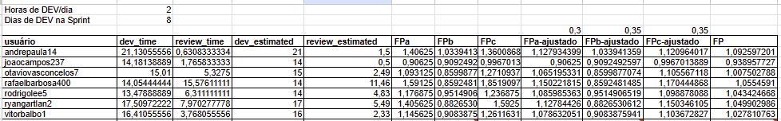
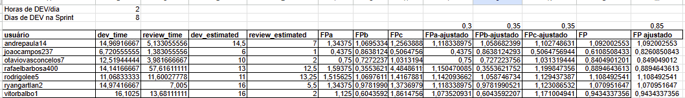
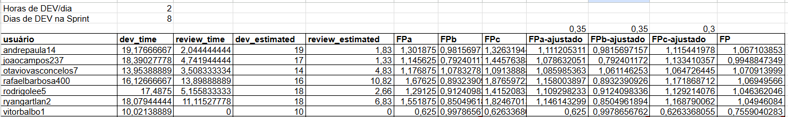

<Table>
  <tr>
    <td>
      
    </td>
    <td>
      
    </td>
  </tr>
</Table>

# Nome do Projeto: Com.Sigo

## Nome do Grupo: Com.Segue

## Integrantes:

- <a href="https://www.linkedin.com/in/andre-lobo-dev/">André Eduardo Lobo de Paula</a>
- <a href="https://www.linkedin.com/in/joao-souza-campos/">João Victor de Souza Campos</a>
- <a href="https://www.linkedin.com/in/otavio-vasc/">Otavio de Carvalho Vasconcelos</a>
- <a href="https://www.linkedin.com/in/rafaelbarbosa-dev/">Rafael Rocha Barbosa</a>
- <a href="https://www.linkedin.com/in/rodrigo-lee/">Rodrigo Hu Tchie Lee</a>
- <a href="https://www.linkedin.com/in/ryan-botelho-gartlan/">Ryan Botelho Gartlan</a>
- <a href="https://www.linkedin.com/in/vitor-balbo/">Vitor Margarido Balbo</a>

# Sumário

- [1. Introdução](#1-introdução)
- [2. Avaliação das Sprints](#2-avaliação-das-sprints)
  - [2.1 Sprint 1](#21-sprint-1)
  - [2.2 Sprint 2](#21-sprint-2)
  - [2.3 Sprint 3](#21-sprint-3)
  - [2.4 Sprint 4](#21-sprint-4)
  - [2.5 Sprint 5](#21-sprint-5)
- [3. Análise de Riscos](#3-análise-de-riscos)
  - [3.1 Riscos identificados](#31-riscos-identificados)
  - [3.2 Mitigação de Riscos](#32-mitigação-de-riscos)
- [4. Análise Post Mortem](#4-análise-post-mortem)
  - [4.1 Sucessos do Projeto](#41-sucessos-do-projeto)
  - [4.2 Oportunidades de Melhoria](#42-oportunidades-de-melhoria)
  - [4.3 Lições Aprendidas](#43-lições-aprendidas)

# 1. Introdução

&nbsp;&nbsp;&nbsp;&nbsp;Este documento estabelece orientações claras de gestão de projetos, definindo boas práticas e metodologias que apoiam o planejamento, monitoramento e controle das iniciativas, visando a eficiência, a colaboração entre a equipe e o alcance dos objetivos propostos. Todos os envolvidos no projeto devem seguir as instruções definidas e contribuir para uma execução bem-sucedida em cada etapa, garantindo o sucesso no cumprimento das metas estabelecidas.

# 2. Avaliação das Sprints

Esta seção mostra como foi a gestão de projetos em cada uma das sprints.

## 2.1 Sprint 1

## Pontos Fortes

&nbsp;&nbsp;&nbsp;&nbsp;A Sprint 1 apresentou um desempenho positivo, com todas as tarefas entregues dentro do prazo estabelecido. A divisão das atividades foi bem equilibrada, garantindo que nenhum membro da equipe ficasse sobrecarregado. Essa boa organização favoreceu o andamento das entregas e manteve um fluxo de trabalho saudável para todos.

## Pontos Fracos

&nbsp;&nbsp;&nbsp;&nbsp;Apesar dos pontos positivos, alguns aspectos ainda precisam ser aprimorados. Houve casos em que membros concluíram suas tarefas, mas demoraram para realizar o commit, o que atrasou a visibilidade do progresso e dificultou eventuais ajustes. Além disso, percebeu-se que poucos integrantes estavam atentos às revisões das tarefas de outros membros, reduzindo a eficácia do processo de revisão de código.

## Sugestões de Melhorias

&nbsp;&nbsp;&nbsp;&nbsp;Para a próxima sprint, recomenda-se a implementação das seguintes ações:

- **Commits mais frequentes**: Ao finalizar uma parte significativa da tarefa, realizar o commit para manter o progresso visível e facilitar ajustes antecipados.
- **Maior atenção nas revisões**: Dedicar tempo para revisar o trabalho dos outros membros, garantindo qualidade e detectando problemas antes da integração.

&nbsp;&nbsp;&nbsp;&nbsp;Com essas melhorias, a equipe poderá manter a boa organização já conquistada e aumentar a qualidade das entregas, fortalecendo ainda mais a colaboração entre os integrantes.

## 2.2 Sprint 2

## Pontos Fortes

&nbsp;&nbsp;&nbsp;&nbsp;A Sprint 2 destacou-se pela excelente colaboração e comunicação entre os membros da equipe. Os integrantes demonstraram maior proatividade em se ajudar mutuamente, compartilhando conhecimentos e solucionando dúvidas de forma coletiva. Essa melhoria na comunicação facilitou a resolução de problemas técnicos e contribuiu para um ambiente de trabalho mais integrado e produtivo.

## Pontos Fracos

&nbsp;&nbsp;&nbsp;&nbsp;Durante esta sprint, identificou-se que a organização do Trello e das tarefas necessita de aprimoramento. A falta de padronização na criação e atualização dos cards gerou confusão sobre o status real das atividades, dificultando o acompanhamento do progresso. Além disso, a equipe poderia ter aproveitado melhor sua capacidade produtiva, puxando algumas tarefas da sprint seguinte para execução antecipada, otimizando assim o cronograma geral do projeto.

## Sugestões de Melhorias

&nbsp;&nbsp;&nbsp;&nbsp;Para a próxima sprint, recomenda-se a implementação das seguintes ações:

- **Padronização do Trello**: Estabelecer um formato padrão para criação de cards e manter o board sempre atualizado.
- **Aproveitamento da capacidade produtiva**: Avaliar a possibilidade de puxar tarefas da sprint seguinte quando há disponibilidade da equipe.
- **Preparo mais organizado pré-sprint**: Dedicar mais tempo ao planejamento e organização das atividades antes do início da sprint para garantir maior clareza e eficiência na execução.

&nbsp;&nbsp;&nbsp;&nbsp;Com essas melhorias, a equipe poderá aproveitar ainda melhor a boa comunicação estabelecida e garantir maior clareza na execução das tarefas.

## 2.3 Sprint 3

#### Pontos Fortes

&nbsp;&nbsp;&nbsp;&nbsp;Nesta sprint, a principal força do grupo foi a capacidade de entrega e a autonomia individual. Mesmo com desafios de organização, conseguimos concluir todo o escopo planejado, o que demonstra o comprometimento e a competência técnica dos membros. Além disso, quando a comunicação fluiu, mostramos ser um time integrado, onde cada um consegue trabalhar no seu ritmo e ajudar quando necessário. Essa resiliência para "fazer acontecer" é um ativo importante do nosso grupo.

#### Pontos Fracos

&nbsp;&nbsp;&nbsp;&nbsp;O nosso maior ponto fraco foi a falta de disciplina na execução dos nossos próprios processos. As nossas reuniões diárias (dailies) nem sempre atingiram seu potencial, o que por vezes gerou um desalinhamento sobre o andamento das tarefas. Essa falha de sincronização se refletiu na organização do nosso quadro no Trello, que poderia ter sido mais claro e ter facilitado ainda mais o acompanhamento do progresso.

#### Plano de Melhoria para a Sprint 3

&nbsp;&nbsp;&nbsp;&nbsp;Para a próxima sprint, nosso foco será em melhorar a forma como trabalhamos juntos, atacando a causa raiz dos nossos desafios de alinhamento e aprendizado. Com base nos feedbacks e na nossa autoavaliação, definimos as seguintes ações prioritárias:

1.  **Reestruturar as Dailies:** Vamos implementar um formato rápido e objetivo, com um facilitador rotativo e foco nas três perguntas essenciais (o que fiz, o que farei, impedimentos). A meta é garantir que todos saiam da reunião sabendo exatamente em que ponto o time está.

2.  **Gestão Ativa dos Feedbacks:** Criaremos um docs para registrar todos os feedbacks recebidos. Em seguida, vamos transformar cada feedback em uma task concreta com um ou mais responsáveis, garantindo que estamos aprendendo e evoluindo continuamente.

3.  **Refinar o Detalhamento das Tarefas:** Durante a planning, vamos dedicar um tempo específico para discutir e quebrar tarefas que pareçam grandes ou complexas demais. A ideia é garantir que cada card no nosso quadro represente uma unidade de trabalho clara e executável, evitando ambiguidades e facilitando a colaboração.

&nbsp;&nbsp;&nbsp;&nbsp;Com essas ações, esperamos resolver nossos desafios de comunicação e planejamento, mantendo a agilidade e a autonomia que já são nossos pontos fortes.

## 2.4 Sprint 4

Durante a Sprint 4, o foco esteve na **conclusão geral do projeto**, garantindo que todas as funcionalidades planejadas fossem entregues com qualidade e alinhamento entre os membros da equipe. Além disso, houve um esforço significativo para consolidar o trabalho em grupo e realizar boas discussões que guiaram as decisões finais do desenvolvimento.

### Pontos Fortes

- **Trabalho em grupo e colaboração**: A equipe manteve um bom nível de interação e apoio mútuo, favorecendo a resolução de problemas e a tomada de decisões em conjunto.
- **Boas discussões durante o desenvolvimento**: As reuniões e interações permitiram debates produtivos, resultando em escolhas mais assertivas para o projeto.
- **Finalização geral do projeto**: Todo o escopo planejado foi concluído, evidenciando comprometimento e dedicação de todos os membros.

### Pontos Fracos

- **Dificuldade no gerenciamento do tempo**: Em alguns momentos, o time enfrentou problemas para equilibrar prazos e prioridades, o que gerou pressão nas entregas finais.
- **Falta de organização na execução das tasks**: Algumas tarefas não estavam claramente definidas ou priorizadas, resultando em retrabalhos e certa perda de eficiência.

### Acompanhamento de Progresso

| Aspecto                        | Sprint 3                                | Sprint 4                                                    |
| :----------------------------- | :-------------------------------------- | :---------------------------------------------------------- |
| **Pontualidade**               | Entregas dentro do prazo                | Impactada por desafios de tempo nas entregas finais         |
| **Priorização das tasks**      | Organização parcial, quadro pouco claro | Falhas na organização geraram momentos de retrabalho        |
| **Divisão de tarefas**         | Boa colaboração entre membros           | Foco coletivo na finalização do escopo                      |
| **Dailys**                     | Algumas inconsistentes                  | Objetivas, mas poderiam ter sido mais frequentes            |
| **Revisões (PRs)**             | Participação crescente, mas irregular   | Estáveis, porém sem checklist definido                      |
| **Apresentação Sprint Review** | Evoluiu com valorização do frontend     | Evidenciou fechamento do ciclo do projeto                   |
| **Validação com professores**  | Feedbacks construtivos sobre UX/UI      | Feedback final positivo, confirmando conclusão do projeto   |
| **Documentação**               | Ainda insuficiente                      | Concluída para entrega final                                |
| **Sugestões implementadas**    | Maioria implementada                    | Priorizadas melhorias críticas                              |
| **Riscos**                     | Novos riscos relacionados à organização | Reduzidos com finalização, mas gestão de tempo segue alerta |

### Sugestões de Melhoria

- **Melhorar gestão do tempo**: Utilizar técnicas como timeboxing ou priorização baseada em valor para equilibrar demandas e prazos.
- **Organização de tasks**: Definir critérios claros para detalhamento e priorização das tarefas, reduzindo ambiguidades e retrabalho.
- **Rituais de acompanhamento mais consistentes**: Garantir frequência e qualidade nas reuniões, principalmente em sprints críticas.
- **Documentação contínua**: Manter atualizações regulares para evitar acúmulo de débito técnico em entregas futuras.

## 2.5 Sprint 5

Durante a Sprint 5, o foco esteve em **finalizar o projeto de forma estável e coerente**, consolidando as entregas realizadas nas sprints anteriores. A equipe manteve um bom ritmo de execução, concluindo grande parte das tarefas com antecedência e garantindo uma entrega final sem contratempos técnicos ou de integração.  

### Pontos Fortes
- **Entrega Antecipada das Funcionalidades**: Grande parte das atividades planejadas foi finalizada logo no início da sprint, permitindo tempo hábil para revisões e pequenos ajustes antes da entrega final.  
- **Conclusão do Projeto sem Bloqueios**: A entrega final ocorreu sem incidentes ou atrasos, evidenciando o amadurecimento do time e a consolidação dos aprendizados das sprints anteriores.  
- **Cooperação e Ritmo de Trabalho Consistente**: A equipe manteve uma cadência estável, com boa comunicação e suporte mútuo para garantir a conclusão do produto.  

### Pontos Fracos
- **Impacto da Prova Final de Módulo**: As avaliações acadêmicas paralelas reduziram a disponibilidade de tempo de alguns membros, afetando o ritmo de execução em determinados momentos.  
- **Imprevisto com o Banco de Dados**: Foi necessário reconfigurar e reimportar dados após um incidente técnico, o que gerou esforço adicional e pequenas pausas no cronograma.  

### Acompanhamento de Progresso

| Aspecto                        | Sprint 3                                                       | Sprint 4                                                    | Sprint 5                                                    |
| :----------------------------- | :------------------------------------------------------------- | :---------------------------------------------------------- | :---------------------------------------------------------- |
| **Pontualidade**               | Entregas dentro do prazo                                       | Impactada por desafios de tempo nas entregas finais         | Recuperada; entregas concluídas antes do prazo              |
| **Priorização das tasks**      | Organização parcial, quadro pouco claro                        | Falhas na organização geraram momentos de retrabalho        | Planejamento eficiente, foco em finalização                 |
| **Divisão de tarefas**         | Boa colaboração entre membros                                  | Foco coletivo na finalização do escopo                      | Equilíbrio entre funções, execução coordenada               |
| **Dailys**                     | Algumas inconsistentes                                         | Objetivas, mas poderiam ter sido mais frequentes            | Reduzidas devido à estabilidade do fluxo                    |
| **Revisões (PRs)**             | Participação crescente, mas irregular                         | Estáveis, porém sem checklist definido                      | Revisões pontuais, com foco em ajustes finais               |
| **Apresentação Sprint Review** | Evoluiu com valorização do frontend                            | Evidenciou fechamento do ciclo do projeto                   | Concluiu com apresentação consolidada e estável             |
| **Validação com professores**  | Feedbacks construtivos sobre UX/UI                            | Feedback final positivo, confirmando conclusão do projeto   | Validação final positiva, destacando qualidade técnica       |
| **Documentação**               | Ainda insuficiente                                             | Concluída para entrega final                                | Refinada e completa para encerramento do módulo             |
| **Sugestões implementadas**    | Maioria implementada                                           | Priorizadas melhorias críticas                              | Todas aplicadas; time consolidado e autônomo                |
| **Riscos**                     | Novos riscos relacionados à organização                        | Reduzidos, mas gestão de tempo ainda sensível               | Riscos mitigados; sistema estável e pronto para entrega      |

### Conclusão Geral do Projeto

&nbsp;&nbsp;&nbsp;&nbsp;Ao longo das cinco sprints, a equipe demonstrou uma **evolução constante em organização, comunicação e maturidade técnica**. Nas sprints iniciais, os principais desafios envolveram a gestão de tempo e a padronização das tarefas — pontos que foram gradualmente resolvidos com a adoção de práticas mais consistentes e com o aumento da sinergia entre os membros.

&nbsp;&nbsp;&nbsp;&nbsp;Durante o desenvolvimento, o grupo aprimorou a **colaboração interdisciplinar entre frontend, backend e análise**, garantindo que as entregas fossem integradas e coerentes com os objetivos do projeto. A partir da Sprint 3, observou-se um crescimento na autonomia individual e na qualidade das revisões, refletindo o amadurecimento do processo de trabalho em equipe.

&nbsp;&nbsp;&nbsp;&nbsp;A Sprint 4 consolidou o projeto tecnicamente e a Sprint 5 simbolizou seu fechamento com **estabilidade, boa documentação e entrega completa**. O grupo demonstrou capacidade de aprendizado contínuo, adaptabilidade e foco em resultados — competências fundamentais para o sucesso do projeto.

**Nota:** Projeto finalizado com êxito, atingindo os objetivos definidos no planejamento inicial e consolidando um fluxo de trabalho colaborativo e eficiente.

## 2.6 Análise da Evolução das Métricas (Sprints 2 a 4)

Esta seção documenta a evolução quantitativa da equipe, utilizando como base as planilhas de métricas aferidas ao final das Sprints 2, 3 e 4. A análise busca correlacionar os dados apresentados em cada imagem com as práticas de trabalho e os desafios de processo discutidos nas retrospectivas.

### 2.6.1 Métricas da Sprint 2

A primeira imagem detalha o desempenho da equipe na Sprint 2, que serviu como uma base de referência para a performance do time.

  Figura 1 – Planilha de Métricas da Sprint 2  
  
  Fonte: Material produzido pelos autores (2025).

**Análise e Insights:**
- **Estimativas Precisas e Produtividade Estável:** A Sprint 2 demonstrou uma forte capacidade de estimativa, com vários membros (como `andrepaula14`, `otaviovasconcelos7`, `ryangartlan2`) cravando o `dev_estimated` com o `dev_time`. O `FP-ajustado` geral da equipe se manteve próximo de 1.0, indicando um ritmo de trabalho saudável e previsível.
- **Primeiro Sinal de Alerta no Fluxo de Revisão:** Apesar do bom desempenho geral, a planilha já aponta um potencial gargalo. O `review_time` de `rafaelbarbosa400` (15.5 horas) é significativamente mais alto que o da maioria, sugerindo que a etapa de revisão já era um ponto de atrito e que os cards poderiam estar parados na coluna de "Revisão" aguardando ação.

### 2.6.2 Métricas da Sprint 3

A planilha da Sprint 3 captura um momento de oscilação na performance da equipe, refletindo os desafios de processo mencionados na retrospectiva correspondente.

  Figura 2 – Planilha de Métricas da Sprint 3  
  
  Fonte: Material produzido pelos autores (2025).

**Análise e Insights:**
- **Queda na Produtividade:** Houve uma queda geral no `FP-ajustado` da equipe, que ficou em média ~0.96. Essa redução, embora pequena, é um reflexo quantitativo da "falta de disciplina na execução dos processos" e do desalinhamento nas *dailies* citados na retrospectiva da Sprint 3.
- **Agravamento Crítico do Gargalo de Revisão:** O `review_time` de `rafaelbarbosa400` escalou para 57.6 horas. Um número tão extremo evidencia uma falha grave no fluxo de trabalho. É a materialização da prática de mover um card para "Revisão" e não realizar a atividade correspondente de imediato. O card ficou parado por dias, inflando o tempo de ciclo e representando um bloqueio claro para a entrega de valor.
- **Impacto em Cascata:** Um tempo de revisão tão longo não afeta apenas uma pessoa; ele prende uma funcionalidade que poderia estar sendo testada ou validada, impactando o trabalho de todo o time.

### 2.6.3 Métricas da Sprint 4

Os dados da Sprint 4 mostram uma recuperação da equipe, indicando que as ações de melhoria propostas na retrospectiva anterior surtiram efeito, embora alguns desafios persistissem.

  Figura 3 – Planilha de Métricas da Sprint 4  
  
  Fonte: Material produzido pelos autores (2025).

**Análise e Insights:**
- **Recuperação da Produtividade:** A equipe demonstrou resiliência, com o `FP-ajustado` médio retornando ao patamar de ~1.0. Isso sugere que a reestruturação das *dailies* e o foco em melhorar a comunicação foram eficazes para realinhar o time. A precisão das estimativas também voltou a ser muito alta.
- **Persistência do Problema de Revisão:** Embora o caso extremo da Sprint 3 tenha sido contornado, o `review_time` continuou sendo um ponto fraco. Diversos membros (`rafaelbarbosa400`, `ryangartlan2`, `vitorbalbo1`) ainda apresentaram tempos de revisão elevados (acima de 10 horas). Isso mostra que, apesar da melhora na comunicação geral, o processo de revisão de código ainda carecia de padronização e prioridade.
- **Atenção aos "Cards Fantasmas" e Atualizações:** O `FP-ajustado` de `vitorbalbo1` (0.75) destoa do resto da equipe. Isso pode indicar uma tarefa subestimada, mas também pode ser um sintoma de um "card fantasma" ou de uma demora em atualizar seu status, fazendo com que o `dev_time` registrado fosse maior que o real esforço de desenvolvimento. A disciplina na gestão do quadro é fundamental para a acurácia das métricas.

### Conclusão Final da Análise de Métricas

A análise cronológica das planilhas revela uma jornada clara: a equipe iniciou com uma base sólida (Sprint 2), enfrentou uma queda de performance devido a falhas de processo (Sprint 3) e demonstrou capacidade de se recuperar (Sprint 4). Os dados confirmam que a competência técnica do time para estimar e desenvolver tarefas é um ponto forte.

Contudo, o maior gargalo e oportunidade de melhoria reside no fluxo de trabalho, especificamente na etapa de revisão de código e na disciplina de gestão do quadro. As práticas de não atualizar os cards em tempo real ou de deixar tarefas acumulando tempo na coluna de revisão são os principais detratores da agilidade da equipe. Para o futuro, o foco deve ser em criar acordos de trabalho claros para a revisão de código e garantir que o quadro seja um espelho fiel do trabalho em andamento.

# 3. Análise de Riscos

&ensp;A análise de riscos é um processo fundamental para o gerenciamento de projetos, permitindo a identificação, avaliação e mitigação de potenciais problemas que podem impactar o sucesso do projeto. Com base no documento do projeto "Com.Sigo", foram identificados os seguintes riscos e suas respectivas estratégias de mitigação.

## 3.1 Riscos identificados

&ensp;Os riscos identificados foram categorizados com base em sua probabilidade de ocorrência e impacto no projeto. A seguir, são apresentados os principais riscos levantados durante a fase de planejamento:

| Risco | Probabilidade | Impacto | Descrição |
| :-- | :--- | :--- | :--- |
| **Ameaças Externas** | Média | Alto | Possíveis mudanças em regulamentos de proteção de dados (LGPD) podem restringir o uso de gravações, afetando a viabilidade do projeto. |
| **Dependência de Ferramentas** | Alta | Médio | A solução depende de serviços externos (Speech-to-Text, PLN), que podem ter custos variáveis, falhas de integração ou descontinuidade. |
| **Complexidade Técnica** | Média | Alto | A integração de diferentes tecnologias (NLP, análise de áudio, banco de dados) pode gerar desafios técnicos inesperados. |
| **Qualidade dos Dados** | Alta | Médio | A precisão da análise depende da qualidade das transcrições e dos dados de áudio, que podem conter ruídos ou inconsistências. |

## 3.2 Mitigação de Riscos

&ensp;Para cada risco identificado, foram propostas ações de mitigação para minimizar seus potenciais impactos. As estratégias adotadas incluem:

| Risco | Ação de Mitigação |
| :-- | :--- |
| **Ameaças Externas** | Acompanhamento contínuo da legislação e implementação de práticas de anonimização de dados para garantir a conformidade. |
| **Dependência de Ferramentas** | Utilização de interfaces de programação de aplicações (APIs) bem documentadas e criação de um módulo de cache (VHS) para respostas da API externa, reduzindo a dependência e os custos. |
| **Complexidade Técnica** | Realização de provas de conceito (PoCs) para validar a integração das tecnologias e capacitação da equipe nas ferramentas selecionadas. |
| **Qualidade dos Dados** | Implementação de pré-processamento dos dados para limpeza e normalização, além da escolha de modelos de transcrição com alta acurácia. |

# 4. Análise Post Mortem

A análise post mortem é uma reflexão estruturada sobre todo o ciclo de vida do projeto "Com.Sigo". O objetivo desta seção é consolidar os sucessos alcançados, identificar as causas-raiz dos desafios enfrentados e transformar a experiência acumulada em lições concretas que possam ser aplicadas em iniciativas futuras. Esta análise representa o fechamento do ciclo de aprendizado da equipe.

## 4.1 Sucessos do Projeto

A equipe "Com.Segue" alcançou resultados notáveis, que vão além da simples entrega do produto. Os principais sucessos podem ser categorizados da seguinte forma:

#### 1. Conclusão Integral do Escopo e Entrega Final de Alta Qualidade
O sucesso mais evidente foi a finalização completa do escopo planejado. Conforme destacado nas retrospectivas das Sprints 4 e 5, o projeto foi concluído com todas as funcionalidades esperadas e a entrega final ocorreu de forma estável e sem incidentes críticos. A capacidade de finalizar grande parte das tarefas da Sprint 5 com antecedência evidencia um planejamento eficaz na reta final e um forte comprometimento da equipe com o objetivo comum.

#### 2. Alta Previsibilidade Técnica e Estabilidade na Produtividade
A análise das métricas das Sprints 2, 3 e 4 revelou uma competência técnica excepcional. A equipe demonstrou uma notável precisão ao alinhar o tempo de desenvolvimento real (`dev_time`) com o estimado (`dev_estimated`), mesmo em meio a desafios de organização. O Fator de Produtividade (`FP-ajustado`) manteve-se consistentemente próximo de 1.0, exceto por uma leve queda na Sprint 3, indicando um ritmo de desenvolvimento maduro, consistente e, acima de tudo, previsível.

#### 3. Resiliência e Capacidade Comprovada de Melhoria Contínua
Talvez o maior testemunho da maturidade da equipe tenha sido sua capacidade de identificar uma queda de performance e corrigi-la. A Sprint 3 foi marcada por uma "falta de disciplina nos processos", o que se refletiu quantitativamente em uma queda no FP e na explosão do tempo de revisão. Em resposta, a equipe implementou ações concretas (como a reestruturação das *dailies*), e os dados da Sprint 4 comprovaram a recuperação da produtividade. Isso demonstra que os rituais de retrospectiva não foram meras formalidades, mas sim catalisadores eficazes de mudança.

#### 4. Colaboração e Sinergia Interdisciplinar
Apesar dos desafios de processo, as retrospectivas consistentemente elogiaram a colaboração e o apoio mútuo entre os membros. A Sprint 2 destacou a "excelente colaboração e comunicação", e a Sprint 4, o "trabalho em grupo" e as "boas discussões durante o desenvolvimento". A equipe soube alavancar a sinergia entre as áreas de frontend, backend e análise para tomar decisões mais assertivas e solucionar problemas complexos de forma coletiva.

## 4.2 Oportunidades de Melhoria

Os desafios enfrentados pelo projeto representam as mais valiosas oportunidades de aprendizado. As áreas a seguir foram identificadas como pontos críticos para aprimoramento em projetos futuros.

#### 1. Formalização e Priorização do Processo de Revisão de Código
Este foi, inequivocamente, o principal gargalo do projeto. A análise do `review_time` revelou picos extremos (chegando a 57.6 horas na Sprint 3), evidenciando que a revisão de código não era tratada como uma etapa prioritária e integrada ao fluxo de trabalho. A prática de mover um card para "Revisão" e deixá-lo em uma fila de espera gerou atrasos, imprevisibilidade e um "estoque" desnecessário de código não integrado.
* **Sugestão para o Futuro:** Implementar um Acordo de Nível de Serviço (SLA) para revisões (ex: toda revisão deve ser iniciada em até 24 horas). Criar um checklist de revisão para padronizar a qualidade e reduzir o tempo de análise. Fomentar a cultura de que a responsabilidade da tarefa só termina quando o código é integrado (`merged`), incentivando revisões mais ágeis.

#### 2. Aprimoramento da Disciplina de Gestão Visual do Trabalho
As retrospectivas das Sprints 2 e 3 apontaram falhas na organização do Trello. Problemas como a demora em mover cards após a conclusão da tarefa, a existência de "cards fantasmas" ou a falta de clareza nas descrições geraram um desalinhamento entre o quadro e a realidade do trabalho. Isso não só dificulta o acompanhamento do progresso, mas também corrompe a fidelidade das métricas coletadas.
* **Sugestão para o Futuro:** Instituir o hábito de atualizar o quadro durante as *dailies*, garantindo que o status de cada tarefa seja discutido e ajustado em equipe. Definir um padrão claro para a criação de cards, incluindo critérios de aceite, para evitar ambiguidades.

#### 3. Consistência e Propósito na Execução dos Rituais Ágeis
A S3 revelou que as reuniões diárias (*dailies*) "nem sempre atingiram seu potencial", tornando-se um ritual sem o foco necessário para sincronizar a equipe e identificar impedimentos. A eficácia dos rituais ágeis depende diretamente do engajamento e da disciplina de todos.
* **Sugestão para o Futuro:** Reforçar o propósito de cada ritual. As *dailies* devem ser rápidas, focadas nas três perguntas clássicas e na remoção de bloqueios. As reuniões de planejamento (*plannings*) devem garantir que as tarefas sejam bem detalhadas antes do início da sprint, evitando surpresas.

## 4.3 Lições Aprendidas

Ao final do projeto "Com.Sigo", a equipe "Com.Segue" adquiriu aprendizados valiosos que transcendem a tecnologia desenvolvida:

1.  **A Disciplina de Processo Amplifica a Competência Técnica:** A equipe provou ser tecnicamente excelente, mas os maiores desafios não foram de código, e sim de fluxo de trabalho. A principal lição é que um processo bem definido e seguido com disciplina é o que permite que o talento técnico se traduza em entrega de valor de forma ágil e consistente.

2.  **Métricas São um Espelho da Realidade, Não a Realidade:** Os números (como um `review_time` alto ou um FP baixo) não são o problema, mas sim o sintoma. A equipe aprendeu a usar as métricas como um diagnóstico para investigar suas práticas de trabalho e confirmar as dores sentidas no dia a dia.

3.  **O Fluxo de Valor é Tão Forte Quanto o Seu Elo Mais Fraco:** O projeto demonstrou que um desenvolvimento rápido é inútil se o código ficar parado em uma longa fila de revisão. A otimização do todo é mais importante que a otimização das partes; o foco deve estar em acelerar o ciclo completo da tarefa, do planejamento à entrega.

4.  **A Cultura de Melhoria Contínua é um Diferencial Competitivo:** A capacidade da equipe de se autoavaliar, identificar falhas e implementar melhorias de forma eficaz (como visto na transição da S3 para a S4) é, talvez, o ativo mais valioso construído durante este projeto. Essa habilidade é a base para o sucesso em qualquer desafio futuro.

