<Table>
  <tr>
    <td>
      <a href="https://www.querocomgas.com.br/?utm_source=google&utm_medium=cpc&utm_term=comg%C3%A1s&utm_campaign=21432544487&utm_content=765228372932&gad_source=1&gad_campaignid=21432544487&gbraid=0AAAAABVP93Y1dgkYEH7cb900l9xETrtQj&gclid=CjwKCAjwtfvEBhAmEiwA-DsKjgFtOeGUYeQECLrAI8S2y4lavUc_XcfZPp2zRsE2z1Vt1NAQdp2__xoCbvYQAvD_BwE">
        
      </a>
    </td>
    <td>
      <a href="https://www.inteli.edu.br/">
        
      </a>
    </td>
  </tr>
</Table>

# Nome do Projeto: Com.Sigo

## Nome do Grupo: Com.Segue

## Integrantes:

- <a href="https://www.linkedin.com/in/andre-lobo-dev/">André Eduardo Lobo de Paula</a>
- <a href="https://www.linkedin.com/in/joao-souza-campos/">João Victor de Souza Campos</a>
- <a href="https://www.linkedin.com/in/otavio-vasc/">Otavio de Carvalho Vasconcelos</a>
- <a href="https://www.linkedin.com/in/rafaelbarbosa-dev/">Rafael Rocha Barbosa</a>
- <a href="https://www.linkedin.com/in/rodrigo-lee/">Rodrigo Hu Tchie Lee</a>
- <a href="https://www.linkedin.com/in/ryan-botelho-gartlan/">Ryan Botelho Gartlan</a>
- <a href="https://www.linkedin.com/in/vitor-balbo/">Vitor Margarido Balbo</a>


# Sumário

- [1. Introdução](#1-introdução)
  - [1.1 Termos e Abreviações](#11-termos-e-abreviações)
  - [1.2 Objetivo do Documento](#12-objetivo-do-documento)
- [2. Entendimento do Projeto e do Negócio](#2-entendimento-do-projeto-e-do-negócio)
  - [2.1 Contexto da Indústria do Parceiro](#21-contexto-da-indústria-do-parceiro)
  - [2.2 Problema](#22-problema)
  - [2.3 Visão do Projeto e do Produto](#23-visão-do-projeto-e-do-produto)
  - [2.4 Personas e Jornada do Usuário](#24-personas-e-jornada-do-usuário)
  - [2.5 Modelagem do Fluxo de Negócio](#25-modelagem-do-fluxo-de-negócio)
    - [2.5.1 Cadeia de Valor](#251-cadeia-de-valor)
    - [2.5.2 Fluxo de Negócio Proposto (AS-IS e TO-BE)](#252-fluxo-de-negócio-proposto-as-is-e-to-be)
  - [2.6 Matriz de Risco do Projeto](#26-matriz-de-risco-do-projeto)
  - [2.7 Matriz SWOT](#26-matriz-swot)
  - [ Ideação](#27-ideação)
  - [2.9 Canvas do Projeto](#28-canvas-do-projeto)
  - [2.10 Business Drivers](#210-business-drivers)
- [3. Requisitos do Projeto](#3-requisitos-do-projeto)
  - [3.1 Requisitos Funcionais (RFs)](#31-requisitos-funcionais-rfs)
  - [3.2 Requisitos Não Funcionais (RNFs)](#32-requisitos-não-funcionais-rnfs)
  - [3.3 Correlação RFs e RNFs](#33-correlação-rfs-e-rnfs)
  - [3.4 Casos de Uso](#34-casos-de-uso)
  - [3.5 Casos de Uso x Requisitos Funcionais](#35-casos-de-uso-x-requisitos-funcionais)
- [4. Modelagem de Dados](#4-modelagem-de-dados)
  - [4.1 Especificação da Base de Dados para Modelo de Recomendação](#41-especificação-da-base-de-dados-para-modelo-de-recomendação)
  - [4.2 Modelo Conceitual de Dados](#42-modelo-conceitual-de-dados)
  - [4.3 Modelo Lógico de Dados](#43-modelo-lógico-de-dados)
  - [4.4 Modelo Físico de Dados](#44-modelo-físico-de-dados)
- [5. Solução Técnica (Design)](#5-solução-técnica-design)
  - [5.1 Diagrama de Classes](#51-diagrama-de-classes)
  - [5.2 Diagrama de Componentes da UML](#52-diagrama-de-componentes-da-uml)
  - [5.3 Diagramas de Sequência da UML](#53-diagramas-de-sequência-da-uml)
- [6. Mapeamento Técnico de Infraestrutura e Implantação](#6-mapeamento-técnico-de-infraestrutura-e-implantação)
  - [6.1 Diagrama de Implantação da UML](#61-diagrama-de-implantação-da-uml)
  - [6.2 Justificativa das Escolhas de Implantação](#62-justificativa-das-escolhas-de-implantação)
  - [6.3 Considerações sobre Desempenho e Segurança](#63-considerações-sobre-desempenho-e-segurança)
- [7. Projeto Visual da Solução](#7-projeto-visual-da-solução)
  - [7.1 Desenvolvimento de Wireframes](#71-desenvolvimento-de-wireframes)
  - [7.2 Desenvolvimento de Mockups](#72-desenvolvimento-de-mockups)
  - [7.3 Guia Visual](#73-guia-visual)
- [8. Desenvolvimento do Projeto](#8-desenvolvimento-do-projeto)
  - [8.1 Arquitetura de Codificação e Estrutura de Diretórios](#81-arquitetura-de-codificação-e-estrutura-de-diretórios)
  - [8.2 Modelo de Recomendação](#82-modelo-de-recomendação)
  - [8.3 Desenvolvimento de Features](#83-desenvolvimento-de-features)
    - [8.3.1 Sprint 3](#831-sprint-3)
    - [8.3.2 Sprint 4](#832-sprint-4)
    - [8.3.3 Sprint 5](#833-sprint-5)
  - [8.4 Testes Unitários e de Integração](#84-testes-unitários-e-de-integração)
  - [8.5 Documentações automáticas](#85-documentações-automáticas)
- [9. Planejamento e Execução de Testes](#9-planejamento-e-execução-de-testes)
  - [9.1 Testes Funcionais](#91-testes-funcionais)
    - [9.1.1 Planejamento](#911-planejamento)
    - [9.1.2 Resultados](#912-resultados)
  - [9.2 Testes de RNFs](#92-testes-de-rnfs)
    - [9.2.1 Planejamento](#921-planejamento)
    - [9.2.2 Resultados](#922-resultados)
  - [9.3 Testes de Usabilidade](#93-testes-de-usabilidade)
    - [9.3.1 Planejamento](#931-planejamento)
    - [9.3.2 Resultados](#932-resultados)
- [10. Procedimentos de Implantação](#10-procedimentos-de-implantação)
  - [10.1 Implantação e Configuração do Banco de Dados](#101-implantação-e-configuração-do-banco-de-dados)
  - [10.2 Implantação do Protótipo para uso por equipe de desenvolvimento](#102-implantação-do-protótipo-para-uso-por-equipe-de-desenvolvimento)
- [Referências](#referências)

# 1. Introdução

A Comgás (Companhia de Gás de São Paulo) é a maior distribuidora de gás natural encanado da América Latina, atuando no estado de São Paulo. A empresa é responsável por levar gás natural canalizado para residências, comércios, indústrias e outros segmentos em sua área de concessão, que inclui a região metropolitana de São Paulo, Campinas, Vale do Paraíba e Baixada Santista

## 1.1 Termos e Abreviações

* RF (Requisitos Funcionais) – Descrevem as funcionalidades e comportamentos esperados do sistema ou software.
* RNF (Requisitos Não Funcionais) – Especificações que definem restrições e qualidades do sistema, como desempenho, segurança e usabilidade.
* CA (Critério de Aceite) – Conjunto de condições que um produto ou funcionalidade deve atender para ser considerado aceito pelo cliente ou equipe.
* T (Teste) – Processo de verificação para garantir que um sistema, software ou produto funciona conforme esperado.
* API (Application Programming Interface) – Conjunto de definições e protocolos que permite a comunicação entre diferentes sistemas ou softwares.
* Features – Funcionalidades ou características específicas de um software ou produto.
* MVP (Minimum Viable Product) – Produto mínimo viável, versão inicial de um produto com funcionalidades básicas para validar sua viabilidade.
* ISO (International Organization for Standardization) – Organização internacional responsável pela padronização e normatização de processos e produtos em diversas áreas.

## 1.2 Objetivo do Documento

&nbsp;&nbsp;&nbsp;&nbsp;Para registrar nosso processo de criação do projeto, desde a idealização até a entrega, desenvolvemos esta documentação. Além de detalhar as fases iniciais de desenvolvimento, o documento explica as tecnologias utilizadas e como foram aplicadas, facilitando a implementação do sistema.

# 2. Entendimento do Projeto e do Negócio

&ensp; Nesta seção, é apresentado o detalhamento completo do entendimento do negócio que norteia este projeto. O objetivo é fornecer uma visão 360º do desafio proposto pela Comgás, começando pela definição clara do problema de negócio e seus impactos diretos na operação e na estratégia da companhia. Em seguida, será apresentada a visão do produto concebido para solucionar este problema, incluindo seus objetivos, funcionalidades e escopo. A análise se aprofunda ao mapear as personas que serão beneficiadas pela solução, os fluxos de negócio envolvidos, e uma matriz estratégica de riscos e oportunidades, culminando na apresentação do Canvas do MVP que guiará o desenvolvimento.

## 2.1 Contexto da Indústria do Parceiro

**Visão Geral do Setor**:

O setor de distribuição de gás natural no Brasil atua em um ambiente altamente regulado, com forte exigência de segurança, confiabilidade e qualidade no atendimento ao cliente. A crescente demanda por energia limpa e eficiente tem impulsionado a digitalização dos serviços, mas o atendimento humano ainda é essencial para resolver questões sensíveis, emergenciais ou complexas. Um dos principais desafios do setor é garantir uma experiência consistente e de alta qualidade, mesmo diante do alto volume de interações e da diversidade de perfis de clientes atendidos.

A Comgás, maior distribuidora de gás natural canalizado da América Latina, atende mais de 2,6 milhões de clientes no Estado de São Paulo. A companhia atende três perfis distintos: pessoas físicas, clientes comerciais (como restaurantes e pequenos comércios) e clientes industriais (como fábricas e grandes indústrias). Enquanto as pessoas físicas representam o maior volume de atendimentos, os clientes industriais são os mais estratégicos, pois o setor industrial responde por mais de 20% do PIB brasileiro e possui alto consumo de gás, sendo um segmento fundamental para a sustentabilidade do negócio.

**Posicionamento do Parceiro**:

A Comgás atua como referência nacional em distribuição de gás natural, não apenas pela escala de sua operação, mas por seu papel de liderança em inovação e experiência do cliente. Em um setor tradicionalmente conservador, a empresa se diferencia por adotar tecnologias avançadas de automação e inteligência artificial como pilares da sua estratégia de atendimento. Com 94% dos atendimentos já resolvidos por canais digitais, como chatbot, URA, WhatsApp e site, a Comgás demonstra um alto nível de maturidade digital, raro entre empresas de infraestrutura no Brasil.

Esse posicionamento a coloca na vanguarda do setor, onde o próximo passo natural não é apenas automatizar mais, mas tornar a qualidade do serviço mensurável, escalável e inteligente. Projetos como o de automação do monitoramento de chamadas com PLN e reconhecimento de áudio são consequência direta dessa postura: enquanto muitas empresas ainda avaliam atendimento de forma manual e pontual, a Comgás busca transformar dados de voz em insights acionáveis, em tempo real e com cobertura massiva. Isso reforça seu compromisso com a excelência operacional e posiciona a empresa como uma utility inteligente, alinhada às demandas de um mercado cada vez mais exigente.

**Contexto Operacional e Desafio Atual**:

A central de atendimento da Comgás recebe entre 120 mil e 150 mil ligações por mês, com toda a operação de atendimento humano terceirizada. Os atendentes, em sua maioria jovens entre 20 e 30 anos, atendem em diversos turnos, 24 horas por dia nos canais de emergência, como vazamentos de gás, e em horário comercial para demandas não emergenciais, como dúvidas sobre faturas, religações e troca de titularidade.

Todas as chamadas são gravadas por obrigatoriedade regulatória. No entanto, apenas cerca de 1% delas são avaliadas manualmente por monitores de qualidade, que escutam cada gravação por completo e verificam critérios como confirmação de dados do cliente (CPF, endereço), cumprimento de roteiros, clareza nas respostas e postura do atendente. Esse processo é lento, pouco escalável e consome tempo operacional, limitando a capacidade da empresa de garantir a qualidade em larga escala.

O atendimento é desafiador por diversos fatores operacionais e comportamentais. A maioria das chamadas chega sem identificação do cliente, exigindo confirmação de dados antes do atendimento. Há também uma forte sazonalidade: no inverno, o consumo de gás aumenta naturalmente, mesmo sem mudança nos hábitos de uso, pois a água entra mais fria e exige mais gás para aquecimento. Isso gera um pico de ligações de clientes preocupados com o valor da conta, muitas vezes por motivos improcedentes, como ter regulado o medidor, recebido visitas que usaram mais água quente ou não compreendido o funcionamento do consumo sazonal.

Apesar de 94% dos atendimentos serem resolvidos por canais digitais, os 6% que transbordam para o atendimento humano trazem os casos mais sensíveis, urgentes ou emocionais. Essas interações muitas vezes envolvem situações de emergência, reclamações financeiras ou risco de perda de cliente. Por isso, a qualidade dessas interações é crítica: resolver rápido, com empatia e precisão é essencial para manter a reputação e a fidelidade.

Nesse cenário, a automação do monitoramento de qualidade se torna um diferencial estratégico. A meta é aumentar a cobertura de análise de 1% para pelo menos 20% das ligações, sem impacto nos custos operacionais. A aplicação de tecnologias como reconhecimento de áudio, processamento de linguagem natural (PLN) e análise de sentimento permite não apenas escalar a avaliação, mas também identificar padrões, mapear boas práticas, detectar falhas recorrentes e realimentar o treinamento de atendentes.

Essa iniciativa está diretamente ligada à estratégia de experiência do cliente (CX) da Comgás: garantir que cada interação, mesmo em larga escala, seja resolutiva, ágil e empática. Automatizar a escuta qualificada não é apenas uma evolução operacional, é uma alavanca para melhoria contínua, retenção de clientes e fortalecimento da reputação da marca.

## 2.2 Problema

### Descrição do Problema
&ensp;A Comgás, maior distribuidora de gás natural canalizado da América Latina, enfrenta um desafio significativo na monitoria da qualidade do seu atendimento telefônico. Com uma central que recebe entre 120 e 150 mil ligações mensais, o método atual de avaliação de qualidade é predominantemente manual e limitado, operando de duas formas:

**Avaliação Direta:** Baseada na nota de satisfação que o cliente atribui ao final do atendimento.

**Análise por Amostragem:** Uma equipe de analistas de qualidade escuta manualmente as gravações de aproximadamente 1% do volume total de chamadas para verificar a conformidade com um checklist de qualidade pré-definido.

&ensp;Este processo, embora importante, é inerentemente lento, caro e não escalável. A amostragem de apenas 1% é insuficiente para gerar uma visão estatisticamente relevante da qualidade geral do serviço, deixando uma lacuna de 99% das interações sem análise aprofundada. Com o crescimento contínuo da base de clientes (cerca de 450 novos por dia), a manutenção desse modelo manual se torna cada vez mais insustentável, gerando um gargalo operacional e estratégico.

&ensp;O cerne do problema é a incapacidade de escalar a monitoria de qualidade na mesma proporção do crescimento da operação, o que impede a Comgás de ter uma visão abrangente e em tempo hábil sobre a experiência real de seus clientes no canal de voz.

### Impacto
&ensp;O problema descrito gera impactos negativos diretos para o negócio e seu posicionamento no setor:

#### Impacto no Negócio:

**Visibilidade Limitada da Experiência do Cliente (CX):** A baixa cobertura da amostragem impede a identificação de problemas sistêmicos, falhas recorrentes em scripts e oportunidades de melhoria no atendimento. Isso pode levar a uma degradação silenciosa da satisfação do cliente.

**Ineficiência Operacional:** O custo de manter uma equipe de analistas para cobrir uma fração tão pequena do total de chamadas é alto. Escalar essa equipe para atingir uma cobertura maior (como os 20% desejados) seria financeiramente inviável no modelo atual.

**Feedback Impreciso para Atendentes:** Com dados limitados, o feedback fornecido aos operadores da central de atendimento pode não ser representativo, dificultando o desenvolvimento e o treinamento direcionado da equipe.

**Tomada de Decisão Reativa:** A falta de dados abrangentes força a gestão a tomar decisões baseadas em informações parciais ou apenas após a escalada de reclamações, em vez de agir proativamente.

#### Impacto no Setor:

**Perda de Competitividade:** No setor de serviços, a experiência do cliente é um diferencial competitivo crucial. Concorrentes que utilizam tecnologias de automação para análise de atendimento podem obter vantagens significativas em eficiência e qualidade.

**Desalinhamento com a Transformação Digital:** Enquanto 94% dos atendimentos da Comgás já ocorrem em canais digitais, a monitoria do canal de voz permanece artesanal. Essa dissonância enfraquece a estratégia de integração e eficiência da companhia.

**Risco à Reputação da Marca:** Falhas de qualidade não detectadas podem levar a experiências negativas que se espalham rapidamente, especialmente em mídias sociais, afetando a percepção pública da marca.

## 2.3 Visão do Projeto e do Produto

### Visão Geral e Objetivo do Produto

&ensp;A solução proposta é uma plataforma de automação para monitoria e análise da qualidade de atendimento (Quality Assurance Automation). O produto visa transformar o processo atual, substituindo a escuta manual e limitada por uma análise automatizada, escalável e baseada em dados, utilizando tecnologias de Inteligência Artificial.

&ensp;O objetivo principal do produto é desenvolver um protótipo funcional que automatize a transcrição e a análise das gravações das chamadas telefônicas, aumentando a cobertura de monitoria de 1% para, no mínimo, 20% do total de ligações, sem acarretar aumento nos custos operacionais.

Como objetivos secundários, a plataforma busca:

- Fornecer insights objetivos e acionáveis para a área de Experiência do Cliente (CX).

- Padronizar os critérios de avaliação, reduzindo a subjetividade humana.

- Reduzir drasticamente o tempo entre a ocorrência da chamada e a sua análise.

- Gerar uma base de dados estruturada para futuras análises preditivas e de causa raiz.

#### O que o Produto Faz (Principais Funcionalidades)

**Processamento de Entradas:** Aceita o envio de arquivos de áudio (gravações de chamadas) e texto para análise.

**Transcrição Automática:** Converte os arquivos de áudio em texto utilizando um serviço de speech-to-text.

**Análise de Conteúdo por PLN:** Utiliza Processamento de Linguagem Natural para analisar o texto transcrito, identificando:

- Sentimento do cliente e do atendente.

- Cumprimento de etapas do script (saudação, despedida, etc.).

- Uso de palavras-chave (positivas ou negativas, como "problema" ou "resolvido").

- Detecção de interrupções, sobreposição de voz e uso de linguagem imprópria.

**Geração de Score de Qualidade:** Atribui uma pontuação objetiva e personalizável a cada chamada com base em critérios pré-definidos (ex: cordialidade, eficiência, conformidade).

**Visualização de Dados:** Apresenta os resultados em uma interface simples (dashboard), exibindo o score da ligação, a transcrição e métricas agregadas (pontuação média, tendências, etc.).

#### O que o Produto Não Faz (Escopo e Limitações)

&ensp;Conforme as restrições do projeto, o protótipo não contemplará:

**Análise em Tempo Real:** A análise será feita em lote (batch processing), a partir de gravações já finalizadas, não durante a chamada.

**Produto Comercializável:** A entrega é um protótipo funcional para validação de conceito, não um software pronto para comercialização.

**Coleta e Rotulagem de Dados:** O projeto assume o recebimento de um conjunto de dados já preparado para o desenvolvimento.

**Disponibilidade Contínua em Nuvem:** A solução não será mantida em ambiente de produção na nuvem após a conclusão do módulo acadêmico.

**Substituição Completa da Análise Humana:** A ferramenta é projetada para escalar a monitoria e direcionar a atenção dos analistas de qualidade para os casos mais críticos ou complexos, e não para eliminar 100% a necessidade de supervisão humana.

## 2.4 Personas e Jornada do Usuário

&emsp;Esta seção apresenta as duas principais personas (Julia Souza, Analista de Qualidade de Atendimento, e Carlos Martins, Supervisor de Atendimento Humano) e suas respectivas jornadas antes e depois da implantação da solução. É importante esclarecer que ambas as personas são usuárias diretas do sistema, utilizando a plataforma para otimizar seus respectivos processos de trabalho. Esses mapas de jornada foram elaborados para revelar as necessidades, pensamentos e pontos de atrito em cada etapa do processo e assim orientar o desenvolvimento das telas, dos fluxos e das funcionalidades do sistema, garantindo que ambos os usuários tenham uma experiência fluida, com mais eficiência, clareza e confiança.

&emsp; Abaixo a imagem da persona **Julia Souza** (Analista de Qualidade de Atendimento):

<div align="center">
  <sub>Figura X - Persona 1 - Julia Souza (Analista de Qualidade de Atendimento)</sub> <br>

  

  <sup>Fonte: Material produzido pelos autores (2025).</sup>
</div>


&emsp; Abaixo as imagens das jornadas da persona **Julia Souza** (Analista de Qualidade de Atendimento):

<div align="center">
  <sub>Figura X – Jornada do Usuário Antes da Solução (Julia Souza, Analista de Qualidade de Atendimento)</sub> <br>

  

  <sup>Fonte: Material produzido pelos autores (2025).</sup>
</div>

<div align="center">
  <sub>Figura X – Jornada do Usuário Depois da Solução (Julia Souza, Analista de Qualidade de Atendimento)</sub> <br>

  

  <sup>Fonte: Material produzido pelos autores (2025).</sup>
</div>


&emsp; Abaixo a imagem da persona **Carlos Martins** (Supervisor de Atendimento Humano):

<div align="center">
  <sub>Figura X - Persona 2 - Carlos Martins (Supervisor de Atendimento Humano)</sub> <br>

  

  <sup>Fonte: Material produzido pelos autores (2025).</sup>
</div>

&emsp; Abaixo as imagens das jornadas da persona **Carlos Martins** (Supervisor de Atendimento Humano):

<div align="center">
  <sub>Figura X – Jornada do Usuário Antes da Solução (Carlos Martins, Supervisor de Atendimento Humano)</sub> <br>

  

  <sup>Fonte: Material produzido pelos autores (2025).</sup>
</div>

<div align="center">
  <sub>Figura X – Jornada do Usuário Depois da Solução (Carlos Martins, Supervisor de Atendimento Humano)</sub> <br>

  

  <sup>Fonte: Material produzido pelos autores (2025).</sup>
</div>

### 2.4.1 Estudo sobre o Usuário do Sistema

Para compreender melhor as necessidades, preferências, habilidades e limitações dos usuários os grupos se reuniram e elaboraram um conjunto de perguntas estratégicas. O objetivo foi mapear de forma estruturada os perfis dos analistas de qualidade, suas práticas atuais e suas expectativas em relação a um sistema automatizado de análise de chamadas.

As perguntas foram consolidadas em um formulário google simples, que equilibra questões objetivas (de múltipla escolha) com uma pergunta aberta, permitindo coletar tanto dados quantitativos quanto qualitativos.

#### 2.4.2 Questionário Elaborado

| Nº | Pergunta | Opções de Resposta |
|----|----------|---------------------|
| 1  | Tempo de experiência na função | - Menos de 1 ano <br> - 1 a 3 anos <br> - 3 a 5 anos <br> - Mais de 5 anos |
| 2  | Como você se considera em relação ao uso de tecnologias e ferramentas digitais? | - Iniciante (uso básico, com dificuldades) <br> - Intermediário (uso bem, mas com ajuda ocasional) <br> - Avançado (domino ferramentas e aprendo rápido) |
| 3  | Quais são os principais pontos que você analisa em uma ligação? | - Conformidade com scripts <br> - Tom de voz/empatia <br> - Tempo de atendimento <br> - Resolução do problema do cliente <br> - Satisfação do cliente <br> - Outro (campo aberto) |
| 4  | O que seria mais importante para você em um sistema de análise automática? | - Confiabilidade dos dados <br> - Rapidez nos resultados <br> - Facilidade de uso <br> - Visualização clara em dashboards <br> - Personalização de métricas <br> - Outro (campo aberto) |
| 5  | Qual formato de material de apoio você acha mais útil para aprender a usar uma nova ferramenta? | - Vídeo explicativo <br> - PDF com passo a passo <br> - Somente interface intuitiva <br> - Todas as opções, se possível |
| 6  | Em poucas palavras, o que tornaria essa ferramenta realmente útil para o seu dia a dia? | Resposta aberta |

#### 2.4.3 Objetivo de Cada Pergunta

- Pergunta 1 – Tempo de experiência na função  
  Ajuda a entender o nível de senioridade dos usuários, permitindo diferenciar necessidades de novatos e veteranos.  

- Pergunta 2 – Familiaridade com tecnologia  
  Identifica o nível de domínio digital dos usuários, fundamental para ajustar a complexidade da interface e os materiais de apoio.  

- Pergunta 3 – Critérios analisados em uma ligação  
  Revela quais aspectos do atendimento são mais relevantes para os analistas e devem ser priorizados na automação.  

- Pergunta 4 – Prioridades no sistema automático  
  Permite identificar o que os usuários mais valorizam (ex.: rapidez, confiabilidade, personalização), servindo como guia para requisitos funcionais.  

- Pergunta 5 – Formato de material de apoio  
  Informa como os usuários preferem aprender a utilizar novas ferramentas, ajudando na definição da estratégia de treinamento e suporte.  

- Pergunta 6 – Expectativas abertas  
  Coleta insights qualitativos, capturando necessidades que não foram previstas nas opções anteriores.  

#### 2.4.4 Respostas Recebidas e Insights
---

#### 2.4.6 Experiências que o Usuário Deverá Vivenciar

Esta seção detalha a jornada interativa do usuário na plataforma, demonstrando como a interface proposta atende às suas necessidades de forma eficiente e intuitiva, em alinhamento com os requisitos do projeto. A experiência foi projetada em um fluxo de quatro etapas, guiando o usuário da visão geral à ação.

#### Jornada do Usuário: Mapeamento do Fluxo Principal

A jornada do usuário foi projetada para ser um fluxo de trabalho eficiente e intuitivo, que chamamos de "Visão Geral → Investigação → Análise Profunda → Ação". O fluxo começa com o usuário obtendo um resumo imediato da "saúde" do atendimento no Dashboard. Em seguida, pode investigar casos relevantes fazendo perguntas em linguagem natural na página de Chat ou ordenando a tabela de chamadas. Ao encontrar um caso específico, o usuário parte para a análise profunda, onde um modal de detalhes apresenta a transcrição e uma análise da IA que explica o porquê da pontuação. Por fim, com os insights adquiridos, o usuário pode planejar ações de melhoria, como ajustar scripts ou criar treinamentos focados, completando o ciclo.

#### Passo 1: Visão Geral (O Panorama em Segundos)

Ao entrar na plataforma, a primeira interação do usuário é com o Dashboard de Qualidade. A experiência é de clareza e controle imediatos. Em segundos, sem a necessidade de nenhum clique, o supervisor absorve a "saúde" da operação através dos Cards de KPI, que destacam a pontuação média geral, o volume de chamadas analisadas e, crucialmente, a quantidade de "Atendimentos Críticos". Esta visão macro instantânea é viabilizada pelos Cards de KPI e pela Tabela de Chamadas Recentes, conforme detalhado no mockup do Dashboard. A apresentação consolidada dos dados materializa o requisito RF03 (Visualizar painel com indicadores gerais), enquanto o destaque visual dos atendimentos problemáticos cumpre o RF06 (Destacar chamadas com desempenho abaixo do limite).

#### Passo 2: Investigação (Conversando com os Dados)

A partir da visão geral, a plataforma convida à investigação de duas formas fluidas. A primeira é visual e exploratória: o usuário pode ordenar a Tabela de Chamadas Recentes por pontuação para, com um clique, trazer os piores ou melhores atendimentos para o topo. A segunda é conversacional e direta: o usuário navega até a tela de Chat e pergunta em linguagem natural, como "quais chamadas tiveram reclamações sobre a fatura?", uma experiência que remove a complexidade de filtros tradicionais. Esta capacidade de busca é sustentada pela Página de Chat e pelo uso de Tags como filtros visuais e contextuais. A qualidade e a precisão das respostas do Chat dependem fundamentalmente do RNF03 (Precisão na Detecção de Intenção), garantindo que a IA compreenda e retorne exatamente o que foi solicitado.

#### Passo 3: Análise Profunda (Entendendo o "Porquê")

Ao identificar uma chamada de interesse, o usuário clica sobre ela e a plataforma abre um Modal de Detalhes, mantendo o contexto do dashboard. A experiência é de insight direcionado. Em vez de apenas ler a transcrição, o usuário é recebido com o "Ponto de vista da IA", um resumo que explica por que a chamada recebeu aquela pontuação, destacando momentos-chave. Isso acelera drasticamente a análise de causa raiz. O protagonista desta etapa é o Modal de Detalhes da Chamada, que centraliza a transcrição, a pontuação e a análise da IA. A capacidade de ver a nota dividida em critérios objetivos atende ao requisito RF02 (Receber três critérios de avaliação com notas de 0 a 5).

#### Passo 4: Ação (Transformando Dados em Melhoria)

A jornada culmina na capacitação para a ação. Após fechar o modal, o usuário não tem apenas dados, mas um entendimento claro do padrão de comportamento que levou a uma nota baixa, o que o torna apto a agir de forma proativa. A experiência final é de eficiência e empoderamento. O usuário pode, então, usar o botão "+ Analisar chamada(s)" para aumentar a amostragem de forma autônoma, validando se as ações de melhoria estão surtindo efeito. A funcionalidade de enviar novas chamadas para análise está diretamente ligada ao RF01 (Enviar entradas em formato de áudio ou texto) e ao RF05 (Upload de múltiplas chamadas), o que dá ao usuário a capacidade de escalar a operação de monitoria conforme o objetivo do projeto.

Em suma, o fluxo de experiência foi planejado para ser mais do que uma sequência de telas. Ele representa a intersecção entre as necessidades das personas, os princípios de uma interface intuitiva definidos na proposta de UX e o cumprimento dos requisitos funcionais e não funcionais do projeto. O resultado é uma solução coesa, eficiente e genuinamente centrada no usuário.

=======
&ensp;A jornada do usuário foi projetada para ser um fluxo de trabalho eficiente e intuitivo, que chamamos de **"Visão Geral → Investigação → Análise Profunda → Ação"**.

### Passo 1: Visão Geral (O Panorama)

&ensp;Ao acessar o **Dashboard**, a primeira experiência de Carlos é obter um resumo imediato da "saúde" do atendimento através dos **KPIs**.

### Passo 2: Investigação (Conversando com os Dados)

&ensp;Usando a página de **Chat**, Carlos pode fazer perguntas em linguagem natural (digitando ou usando o microfone) para encontrar os casos mais relevantes, como:

> "Me mostre as piores chamadas do mês de julho."

&ensp;A tabela no Dashboard também permite uma investigação visual, onde ele pode ordenar as chamadas por data ou pontuação.

### Passo 3: Análise Profunda (Entendendo o "Porquê")

&ensp;Ao clicar em uma chamada específica (seja na tabela do Dashboard ou em um resultado do Chat), um **Modal de Detalhes** se abre.  
&ensp;Aqui, a experiência é de clareza e insight, onde a plataforma apresenta não apenas a transcrição, mas uma análise da IA que explica o porquê da pontuação e das tags.

### Passo 4: Ação (Transformando Dados em Melhoria)

&ensp;Com os insights do **"Ponto de vista da IA"**, Carlos pode identificar padrões de comportamento e planejar ações de melhoria para toda a equipe, como ajustar scripts ou criar treinamentos focados.

---

## 2.5 Modelagem do Fluxo de Negócio

Como parte do entendimento do negócio, foi modelado o fluxo de processo atual (AS-IS) de avaliação da qualidade do atendimento prestado aos clientes da Comgás, utilizando a notação BPMN (Business Process Model and Notation). O objetivo deste mapeamento é representar de forma clara as etapas e interações entre os principais atores responsáveis pelo atendimento e pela análise de conformidade com os padrões da empresa.

Como a única alteração relevante com a aplicação da solução proposta seria a substituição da atuação humana na etapa de monitoria por um sistema automatizado de análise com IA, optou-se por modelar apenas o fluxo atual (AS-IS). Na prática, o processo seguiria exatamente as mesmas etapas, mas a avaliação das chamadas seria executada pela IA em vez de um monitor humano, podendo, no melhor cenário, substituir totalmente o trabalho manual. A única mudança visível no diagrama seria a renomeação da lane de “Monitor” para “Sistema de Monitoramento” e a inclusão da geração automática de relatórios ou o envio direto das métricas para um dashboard.

**Atores Principais**

* **Cliente**: Consumidor dos serviços da Comgás, podendo ser pessoa física, comércio ou indústria. É quem identifica uma demanda (ex.: conta alta, religação de gás, vazamento) e aciona os canais de atendimento.

* **Cris / Canais Digitais**: Chatbot e outros canais automatizados (WhatsApp, chat no site, SMS) responsáveis por resolver demandas simples e recorrentes, como emissão de segunda via de conta ou informações básicas.

* **Atendente Humano**: Profissional terceirizado que atende demandas mais complexas, como emergências, contestações de conta e problemas técnicos. O atendente deve seguir protocolos da Comgás, como confirmar a identidade do cliente e, quando necessário, abrir uma Nota de Serviço (OS).

* **Sistema de Gravação**: Responsável por registrar 100% das ligações, conforme exigência regulatória. A gravação ocorre em paralelo ao atendimento, do início ao fim da chamada.

* **Monitor de Qualidade**: Funcionário terceirizado que avalia, por amostragem, a aderência do atendimento aos padrões da Comgás. Hoje, cerca de 1% das chamadas são avaliadas, o que corresponde a aproximadamente duas ligações por atendente.

### **Fluxo de Negócio do Processo Atual (AS-IS)**

<div align = center>

</div>

O fluxo inicia quando o cliente identifica uma demanda e aciona um dos canais de suporte. A partir daí:

1. **Entrada do cliente nos canais de atendimento**
   O cliente entra em contato com o suporte por telefone, chatbot Cris, WhatsApp, chat no site ou SMS.

2. **Decisão inicial**
   Se a demanda for simples e puder ser solucionada pela Cris ou outro canal automatizado, o processo é encerrado. Caso contrário, a chamada é direcionada a um atendente humano.

3. **Atendimento humano**
   O atendente segue protocolos estabelecidos: confirmar dados do cliente, compreender a demanda, verificar informações no sistema e, se necessário, abrir uma Nota de Serviço.

4. **Gravação da chamada em paralelo**
   Enquanto o atendimento ocorre, o sistema de gravação registra integralmente a ligação.

5. **Seleção da amostra de chamadas**
   Após o atendimento, o monitor de qualidade seleciona, seguindo critérios internos (ex.: 2 chamadas por atendente), as ligações que serão avaliadas.

6. **Avaliação de qualidade**
   O monitor acessa a gravação e verifica a aderência do atendimento aos padrões da Comgás, como cordialidade, cumprimento de roteiro, conferência de dados e clareza das informações prestadas.

O processo é encerrado após a conclusão da avaliação pelo monitor.

**Representação das cores no BPMN**

* **Roxo**: Representa subprocessos, indicando que a atividade é composta por várias etapas internas que não estão detalhadas no diagrama, mas fazem parte do procedimento padrão.

* **Laranja**: Indica pontos de decisão no processo, onde é avaliado um critério que determina o fluxo seguinte (ex.: demanda resolvível digitalmente ou não).

* **Vermelho**: Representa eventos de término do processo, encerrando o fluxo em diferentes cenários possíveis.

* **Azul**: Representa dados gerados ou consumidos ao longo do processo


Em conclusão, o mapeamento BPMN do processo atual de avaliação da qualidade no atendimento telefônico da Comgás permitiu identificar de forma clara o papel de cada ator, as interações entre eles e a sequência lógica das atividades. Embora o fluxo de atendimento ao cliente não se altere significativamente com a introdução da solução proposta, o uso de tecnologias de reconhecimento de voz e processamento de linguagem natural na etapa de monitoria tem potencial de multiplicar quantidade de chamadas avaliadas, aumentando a cobertura sem acréscimo de custo operacional. Esse ganho de escala contribui para maior precisão no monitoramento da experiência do cliente, reforça a capacidade de identificar desvios de padrão e oferece à Comgás mais dados para melhorar continuamente seu atendimento.

## 2.5.1 Cadeia de Valor

_conteúdo_

## 2.6 Matriz de Risco do Projeto

### Matriz de Risco

&emsp;Nesta seção se encontra a matriz de riscos do projeto.

<div align="center"> <sub>Imagem 2.6.1 - Matriz de Riscos</sub><br>

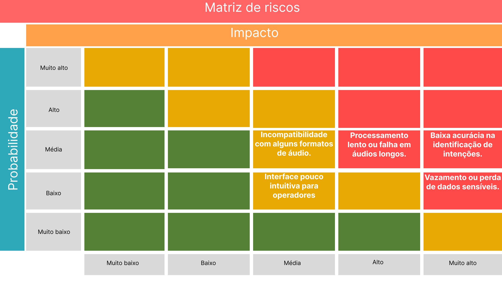

<sup>Fonte: Material produzido pelos autores (2025)</sup>

</div>

<div align="center"> <sub>Tabela 2.6.1 - Tabela de Riscos</sub><br>

| Nº  | Risco                                         | Probabilidade | Impacto    | Mitigação                                                                                 |
| --- | --------------------------------------------- | ------------- | ---------- | ----------------------------------------------------------------------------------------- |
| 1   | Processamento lento ou falha em áudios longos | Média         | Alto       | Otimizar algoritmos de transcrição; usar processamento assíncrono; limitar simultaneidade |
| 2   | Baixa acurácia na identificação de intenções  | Média         | Muito alto | Treinar e validar modelos com dados variados; implementar feedback para correção manual   |
| 3   | Vazamento ou perda de dados sensíveis         | Baixa         | Muito Alto | Implementar criptografia local; políticas rígidas de acesso; logs de auditoria            |
| 4   | Interface pouco intuitiva para operadores     | Baixa         | Média      | Realizar testes de usabilidade; coletar feedback dos usuários e iterar no design          |
| 5   | Incompatibilidade com formatos de áudio       | Média         | Média      | Suportar múltiplos formatos comuns; validar arquivos antes do processamento               |

<sup>Fonte: Material produzido pelos autores (2025)</sup>

</div>

### Matriz de Oportunidade

&emsp;Nesta seção se encontra a matriz de riscos do projeto.

<div align="center"> <sub>Imagem 2.6.2 - Matriz de Oportunidades</sub><br>

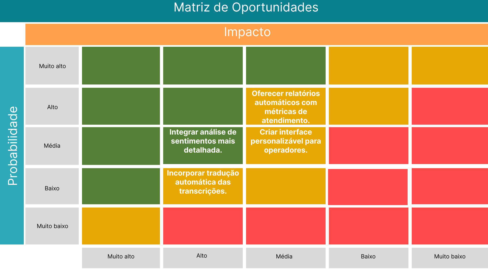

<sup>Fonte: Material produzido pelos autores (2025)</sup>

</div>

<div align="center"> <sub>Tabela 2.6.2 - Tabela de Oportunidades</sub><br>

| Nº  | Oportunidade                                                | Probabilidade | Impacto | Mitigação/Ação Potencial                                                                 |
| --- | ----------------------------------------------------------- | ------------- | ------- | ---------------------------------------------------------------------------------------- |
| 3   | Oferecer relatórios automáticos com métricas de atendimento | Alta          | Médio   | Desenvolver módulo de relatórios integrado; coletar métricas-chave de forma automatizada |
| 4   | Integrar análise de sentimentos mais detalhada              | Média         | Alto    | Implementar modelos de NLP mais avançados e treinar com dados específicos da empresa     |
| 8   | Incorporar tradução automática das transcrições             | Baixa         | Alto    | Integrar APIs de tradução; permitir configuração de idiomas prioritários                 |
| 10  | Criar interface personalizável para operadores              | Alta          | Médio   | Adicionar opções de layout, atalhos e personalização de dashboards                       |

<sup>Fonte: Material produzido pelos autores (2025)</sup>

</div>

## 2.7 Análise SWOT

&nbsp;&nbsp;&nbsp;&nbsp;A matriz SWOT é uma ferramenta de análises de mercado utilizada para identificar e analisar as forças (Strengths), fraquezas (Weaknesses), oportunidades (Opportunities) e ameaças (Threats) de uma empresa ou projeto. O objetivo dessa análise é oferecer uma visão clara e agrangente das condições internas e externas que podem impactar no desenvolvimento de um projeto e no desempenho da empresa, o que ajuda na formulação de estratégias eficientes para alcançar os objetivos empresariais.

<div align="center">
<sub>Figura 2.7.1 - Matriz Swot</sub><br>
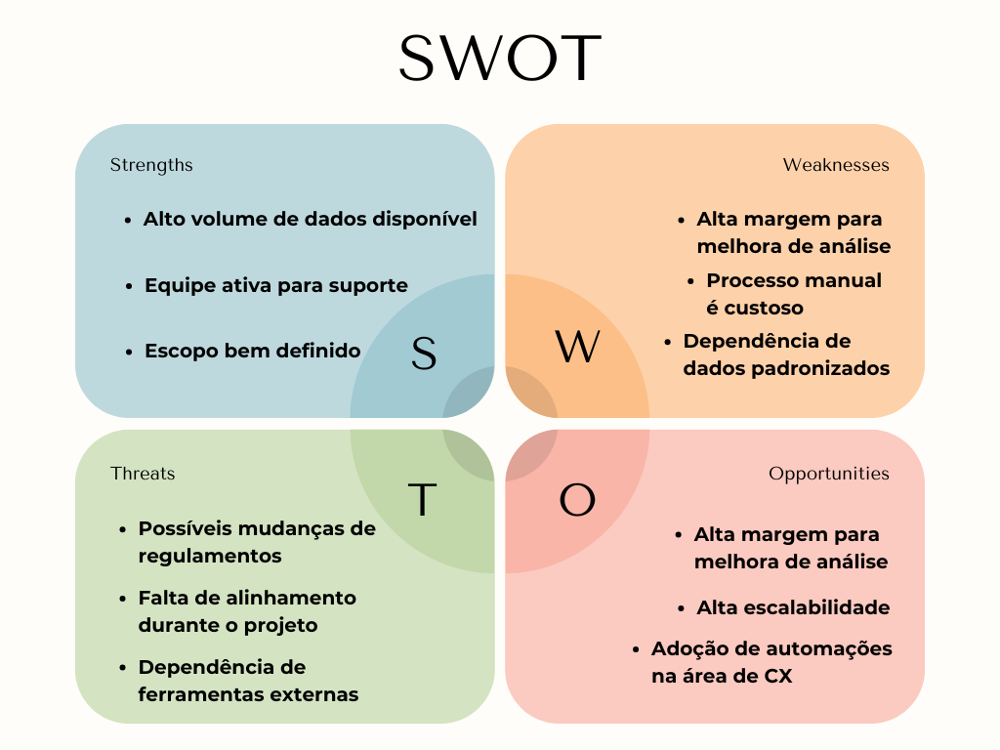<br>
<sup>Fonte: Material produzido pelos autores (2025)</sup>
</div>

#### Forças (Strengths)

1. **Alto volume de dados disponível**

   - A **Comgás** possui alto volume de dados de atendimento acumulados, com ligações e interações por canais digitais. Isso nos ajuda a criar e validar modelos de análise, com representatividade e confiabilidade estatística.

2. **Equipe ativa para suporte**

   - O projeto conta com o envolvimento direto de profissionais das áreas de inovação, tecnologia e canais digitais da **Comgás**. Esse suporte ajuda no alinhamento com as necessidades reais da empresa, facilita o acesso a dados e aumenta as chances de adoção futura.

3. **Escopo bem definido**
   - O projeto possui objetivos claros e delimitados, com entregáveis tangíveis do MVP. Essa definição garante a organização da equipe, no controle das entregas e na avaliação das métricas do projeto.

#### Fraquezas (Weaknesses)

1. **Alta margem para melhora de análise**

   - Atualmente, apenas cerca de 1% das ligações é analisada manualmente, o que indica pouca visibilidade sobre a qualidade do atendimento. Isso limita a base de comparação para validação e pode dificultar a melhora inicial dos modelos.

2. **Processo manual é custoso**

   - O modelo atual de escuta humana consome tempo e recursos operacionais significativos, dificultando a escalabilidade. Essa dependência do fator humano compromete a eficiência e impõe limites rígidos à expansão da análise.

3. **Dependência de dados padronizados**
   - O projeto exige que os dados de entrada (transcrições, gravações e anotações) estejam limpos e padronizados. Isso pode se tornar um gargalo, caso os dados sejam entregues de forma desorganizada.

#### Oportunidades (Opportunities)

1. **Alta escalabilidade**

   - Uma vez validado, o modelo de análise automatizada pode ser ampliado para cobrir grande parte ou até a totalidade dos atendimentos. A **Comgás** poderá multiplicar a cobertura da monitoria e extrair insights em tempo real.

2. **Alta margem para melhora de análise**

   - A baixa cobertura atual representa também uma grande oportunidade: há um espaço amplo para crescimento do volume de interações analisadas, o que pode gerar impactos diretos na qualidade do atendimento e na experiência do cliente.

3. **Adoção de automações na área de CX**
   - O mercado está em crescente movimento de automação de processos de Customer Experience, com ampla aceitação de tecnologias como NLP e IA. Isso cria um ambiente favorável para que a **Comgás** adote soluções inovadoras com bom retorno estratégico.

#### Ameaças (Threats)

1. **Possíveis mudanças de regulamentos**

   - Alterações na legislação de proteção de dados (como a LGPD) ou novas diretrizes internas podem restringir o uso de gravações ou exigir anonimização mais rigorosa, afetando a viabilidade do projeto.

2. **Falta de alinhamento durante o projeto**

   - O envolvimento de múltiplos pontos de contato (negócio, inovação, dados) pode gerar desalinhamentos de expectativa ou prioridades, o que pode comprometer prazos e decisões técnicas ao longo do desenvolvimento.

3. **Dependência de ferramentas externas**
   - A solução depende de serviços externos (como speech-to-text e PLN em nuvem), que podem ter custos variáveis, limitações de uso gratuito, falhas de integração ou até descontinuidade, impactando a estabilidade e escalabilidade do protótipo.

## 2.8 Ideação
Esta seção apresenta o levantamento de funcionalidades potenciais para o projeto, com base no contexto da Comgás, no problema de negócio, nos requisitos funcionais (RFs) e não funcionais (RNFs) definidos, e nas diretrizes do MVP.

O objetivo é identificar funcionalidades que atendam ao escopo do projeto, com alto impacto na qualidade do atendimento e viabilidade técnica, priorizando aquelas essenciais para o MVP.

### 2.8.1 Metodologia de Priorização

Utilizamos uma matriz Impacto vs Viabilidade, considerando:

- **Impacto**:
  1. Alinhamento com o objetivo principal: automatizar e escalar a avaliação de qualidade
  2. Contribuição para retenção de clientes, reputação e melhoria contínua
  3. Geração de insights acionáveis para gestão e treinamento

- **Viabilidade**:
  1. Alinhamento com os requisitos funcionais e não funcionais
  2. Adequação ao MVP (protótipo funcional com score, dashboard e validação)

As funcionalidades foram classificadas em:
- **MVP (Must Have)** – Essenciais para entrega
- **Futuro (Nice to Have)** – Estratégicas, mas fora do escopo atual

<div align="center">

| ID | Nome da Feature | Descrição | Vinculação com RFs/RNFs | Classificação |
|----|------------------|-----------|--------------------------|---------------|
| F01 | Classificação Automática de Entrada (Áudio/Texto) | Identifica automaticamente se a entrada é áudio ou texto e direciona para o fluxo adequado. | RF01, RF04, RNF02, RNF03 | MVP |
| F02 | Transcrição de Áudio com Suporte a Longas Durações | Converte arquivos de áudio (até 75 min) em texto, garantindo completude. | RF01, RNF01, RNF02 | MVP |
| F03 | Geração de Score de Qualidade (0 a 5) | Atribui pontuação com base em três critérios objetivos, conforme RF02. | RF02, RNF03 | MVP |
| F04 | Análise de Sentimento e Intenção | Detecta emoções e intenções com precisão ≥90%, conforme RNF03. | RF02, RF06, RNF03 | MVP |
| F05 | Dashboard de Indicadores de Qualidade | Painel com métricas agregadas: média de score, % de chamadas abaixo do limite. | RF03, RF06 | MVP |
| F06 | Upload em Lote de Chamadas | Permite envio simultâneo de múltiplas chamadas para análise em massa. | RF05, RNF01 | MVP |
| F07 | Armazenamento Seguro de Dados | Armazena entrada, transcrição, score e metadados com segurança. | RF07, RNF01, RNF03 | MVP |
| F08 | Destaque de Atendimentos Críticos | Identifica e destaca chamadas com score abaixo do limite definido. | RF06 | MVP |
| F09 | Identificação de Atendimentos "Top" (Excelência) | Destaca chamadas com desempenho máximo para uso em treinamento. | — | Futuro |
| F10 | Análise de Transbordo do Canal Digital | Cruzamento entre chamadas que vieram do chatbot e motivo do atendimento. | — | Futuro |
| F11 | Detecção de Risco de Perda de Cliente | Identifica frases de insatisfação ou ameaça de cancelamento. | — | Futuro |
| F12 | Recomendação de Treinamento por Padrão de Erro | Mapeia erros recorrentes e sugere treinamentos personalizados. | — | Futuro |
</div>

Tabela de Priorização: Impacto vs Viabilidade

<div align="center">

| Feature | Impacto | Viabilidade | Prioridade Final | Categoria |
|--------|--------|------------|------------------|----------|
| F01 – Classificação Automática | Alto | Alta | Alta | MVP |
| F02 – Transcrição de Áudio | Alto | Alta | Alta | MVP |
| F03 – Geração de Score | Alto | Alta | Alta | MVP |
| F04 – Análise de Sentimento | Alto | Média | Alta | MVP |
| F05 – Dashboard | Médio | Alta | Alta | MVP |
| F06 – Upload em Lote | Médio | Alta | Alta | MVP |
| F07 – Armazenamento de Dados | Médio | Alta | Alta | MVP |
| F08 – Destaque de Críticos | Médio | Alta | Alta | MVP |
| F09 – Atendimentos "Top" | Médio | Média | Média | Futuro |
| F10 – Análise de Transbordo | Alto | Média | Média | Futuro |
| F11 – Risco de Perda | Alto | Baixa | Média | Futuro |
| F12 – Recomendação de Treinamento | Alto | Média | Média | Futuro |
</div>

Alinhamento com Requisitos

<div align="center">

| Feature | RF01 | RF02 | RF03 | RF04 | RF05 | RF06 | RF07 | RNF01 | RNF02 | RNF03 |
|--------|------|------|------|------|------|------|------|-------|-------|-------|
| F01 | ✅ | ⬜ | ⬜ | ✅ | ⬜ | ⬜ | ⬜ | ⬜ | ✅ | ✅ |
| F02 | ✅ | ⬜ | ⬜ | ⬜ | ✅ | ⬜ | ✅ | ✅ | ✅ | ⬜ |
| F03 | ✅ | ✅ | ⬜ | ⬜ | ⬜ | ⬜ | ⬜ | ⬜ | ⬜ | ✅ |
| F04 | ✅ | ✅ | ✅ | ✅ | ⬜ | ✅ | ✅ | ⬜ | ⬜ | ✅ |
| F05 | ⬜ | ⬜ | ✅ | ⬜ | ⬜ | ✅ | ⬜ | ⬜ | ⬜ | ✅ |
| F06 | ✅ | ⬜ | ⬜ | ⬜ | ✅ | ⬜ | ⬜ | ✅ | ✅ | ⬜ |
| F07 | ⬜ | ⬜ | ⬜ | ⬜ | ⬜ | ⬜ | ✅ | ✅ | ⬜ | ✅ |
| F08 | ⬜ | ⬜ | ⬜ | ⬜ | ⬜ | ✅ | ⬜ | ⬜ | ⬜ | ✅ |

</div>

### 2.8.2 Roadmap Previsto

A priorização das funcionalidades foi desenvolvida com base na facilidade de implementação, no valor entregue para a Comgás e na coerência com o cronograma acadêmico. As features foram distribuídas entre as sprints 3, 4 e 5 de forma a garantir um desenvolvimento incremental, viabilizando a integração contínua entre processamento de áudio, geração de score, armazenamento de dados e interface de visualização, sempre alinhado ao escopo do MVP.

<div align="center">

| Sprint | Funcionalidades | Objetivo |
|--------|------------------|---------|
| 3 | F01, F02, F03, F04 | Implementar a recepção e classificação de entradas (áudio/texto), transcrição de áudio, análise de sentimento e geração inicial do score com base em três critérios. Inicia-se a base do motor de avaliação automatizada. |
| 4 | F05, F06, F07 | Desenvolver o dashboard básico, habilitar upload em lote de chamadas e implementar o armazenamento seguro dos dados processados, integrando a solução com o banco de dados. |
| 5 | F08 | Implementar o destaque automático de chamadas com desempenho abaixo do limite definido, permitindo ações corretivas rápidas. Concluir com a validação cruzada entre análise automática e avaliação humana. |

</div>

Em conclusão, todas as funcionalidades do MVP estão diretamente vinculadas aos requisitos definidos no projeto. A solução proposta permite automatizar a avaliação de qualidade com foco em escalabilidade, acurácia e custo-efetividade. Ao final da sprint 5, o protótipo entregue será capaz de processar chamadas em áudio ou texto, gerar um score de qualidade com base em três critérios, exibir métricas em um dashboard simples e destacar atendimentos abaixo do padrão, atendendo integralmente ao escopo do MVP.

## 2.9 Definição da Estratégia de Entrega para as Sprints 3, 4 e 5

Esta seção detalha a estratégia de entrega das sprints 3, 4 e 5, com foco no desenvolvimento e integração do backend. A abordagem é incremental, alinhada aos requisitos funcionais e não funcionais definidos, e compatível com as exigências acadêmicas do projeto. As etapas de design, desenvolvimento, testes e implantação são estruturadas para garantir qualidade, escalabilidade e integração contínua.

A estratégia foi construída com base no roadmap do MVP, nas entregas obrigatórias por sprint e na especificação técnica inicial, com evoluções documentadas conforme o avanço do projeto.

### Sprint 3: Fundação do Backend e Processamento Inicial

Nesta sprint, é desenvolvida a base do backend para recepção, classificação e processamento inicial de entradas em áudio e texto.

São implementadas:
- API para upload de arquivos de áudio e texto (RF01, RF04)
- Classificação automática do tipo de entrada, com identificação precisa entre áudio e texto
- Integração com serviço de transcrição (Speech-to-Text) para conversão de áudio em texto
- Módulo inicial de processamento com NLP para detecção de intenções e sentimento (RNF03)
- Geração de score preliminar com base em três critérios de qualidade (RF02)

O armazenamento é temporário, com metadados registrados para suporte ao fluxo de avaliação.

Paralelamente, é realizado o planejamento dos testes:

- Testes funcionais baseados nos requisitos (RFs)
- Testes não funcionais focados em desempenho (RNF02) e precisão (RNF03)
- Testes de integração entre componentes internos e serviços externos
- Roteiro de testes de usabilidade com 5 usuários externos, incluindo cenários, perfis e métricas (ex: SUS)
- Definição das ferramentas e bibliotecas a serem utilizadas
- Implementação do módulo VHS para cache de respostas da API externa

As especificações técnicas da Sprint 1 são revisadas e atualizadas com base no progresso, garantindo coerência com o MVP. Alterações no modelo de dados e nos fluxos de processamento são documentadas no `Projeto.md`.

### Sprint 4: Persistência, Integração e Implantação

Nesta sprint, o backend é consolidado com armazenamento persistente, integração assíncrona e início da implantação em ambiente de produção.

São implementadas:
- Integração com o banco de dados definido na seção de pilha de tecnologias para armazenamento seguro de chamadas, transcrições, scores e metadados (RF07)
- Upload em lote de chamadas (RF05)
- Configuração de dois webhooks para notificação de eventos (ex: conclusão de transcrição e avaliação)
- Sistema de mensageria para orquestração de processos assíncronos
- Endpoints para consulta e exportação de dados, apoiando a geração de indicadores

O backend é integrado ao frontend em desenvolvimento, permitindo a visualização de resultados.

Nesta fase, são executados os testes planejados na Sprint 3:
- Casos de teste detalhados são aplicados, com cobertura total dos requisitos funcionais
- Registros de execução incluem logs, capturas de tela e evidências de sucesso ou falha
- Testes de usabilidade são realizados com usuários externos, com documentação de feedback e sugestões de melhoria
- Resultados são analisados criticamente, com identificação de problemas funcionais e oportunidades de ajuste

É realizada a configuração do ambiente de produção e documentado o processo de deploy. O sistema é preparado para a validação final.

### Sprint 5: Integração Completa, Validação e Entrega Final

Nesta sprint, o sistema é finalizado com integração total entre frontend e backend, validação cruzada e correção de bugs.

São concluídas:
- Geração de score com base nos três critérios definidos (RF02)
- Destaque automático de chamadas com desempenho abaixo do limite (RF06)
- Exposição de dados agregados para o dashboard (RF03)
- Tratamento robusto de erros e logs detalhados

O frontend é totalmente integrado ao backend, com testes de integração validando todas as funcionalidades.

É realizada a validação do MVP:
- Comparação entre a análise automática e a avaliação humana de uma amostra de chamadas
- Correção de bugs e ajustes com base em feedback de professores e parceiro
- Revisão final das especificações técnicas, com atualização de qualquer componente que tenha evoluído

O protótipo é finalizado, documentado e entregue conforme o escopo do projeto.

Em conclusão, a estratégia de entrega para as sprints 3, 4 e 5 assegura o desenvolvimento progressivo e integrado do backend, alinhado ao MVP e às exigências acadêmicas. Cada sprint entrega valor funcional, com foco em qualidade, escalabilidade e integração.

## 3. Canvas do Projeto

&nbsp;&nbsp;&nbsp;&nbsp;Segue abaixo, o Canvas MVP da aplicação web desenvolvido a partir das atividades realizadas durante os encontros com o parceiro e as discussões em grupo.

<div align="center">
<sub>Figura 2.9.1 - Canvas MVP do projeto</sub><br>
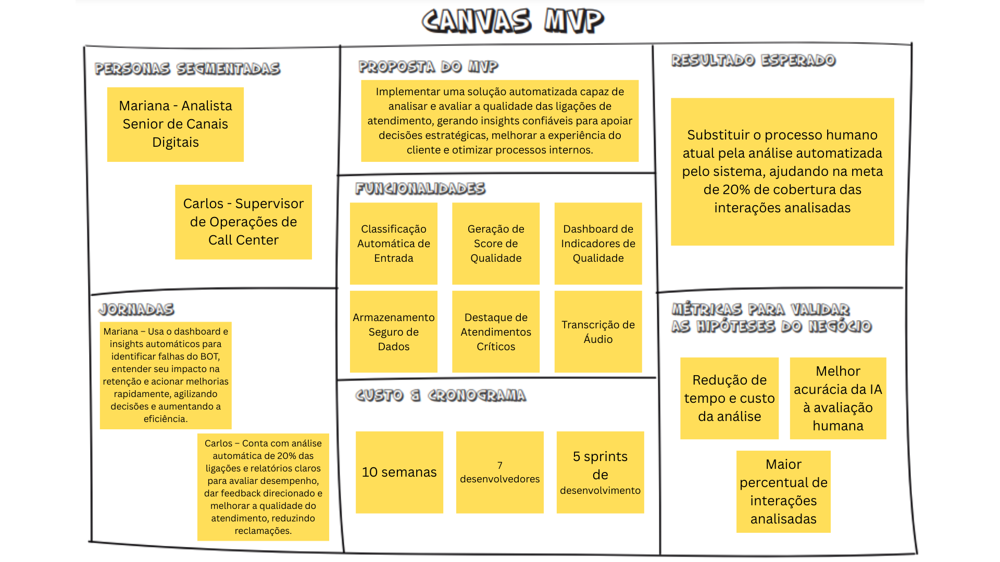<br>
<sup>Fonte: Material produzido pelos autores (2025) </sup>
</div>

## 2.10 Business Drivers

### 1. Contexto
A **Comgás**, maior distribuidora de gás natural canalizado da América Latina, atende mais de **2,6 milhões de clientes**, com média de **450 novos clientes por dia**.
O atendimento ocorre por múltiplos canais, sendo **94% das interações digitais** (WhatsApp, aplicativo, site e chatbot).

O monitoramento de qualidade das ligações telefônicas hoje é feito por:
- Avaliação direta da nota atribuída pelo cliente.
- Escuta manual de aproximadamente **1% das chamadas**, realizada por analistas de qualidade.

Essa abordagem manual, embora útil, apresenta **baixa cobertura, alto custo relativo e pouca escalabilidade**.

---

### 2. Problema de Negócio
- Cobertura de monitoramento limitada (apenas 1% das ligações).
- Dependência de recursos humanos, dificultando escalabilidade.
- Métricas pouco padronizadas e variáveis entre avaliadores.
- Demora na detecção de problemas de atendimento.
- Risco de queda na qualidade com a rápida expansão da base de clientes.

---

### 3. Necessidade de Mudança
Para manter a qualidade do atendimento e sustentar o crescimento, é necessário **automatizar a escuta e avaliação das chamadas**.
O uso de **Inteligência Artificial (IA)** e **Processamento de Linguagem Natural (NLP)** permitirá:
- Aumentar a amostragem analisada de forma massiva.
- Garantir padronização e consistência de métricas.
- Reduzir o tempo entre a ocorrência e a correção de problemas.
- Manter custos sob controle mesmo com aumento de volume.

---

### 4. Oportunidade
O projeto prevê o desenvolvimento de uma solução **automatizada e escalável** de monitoramento de qualidade, utilizando:
- **Speech-to-Text** para transcrição automática das ligações.
- **NLP** para análise de intenção e cumprimento de roteiro.
- **Análise de sentimento** para medir cordialidade e empatia.
- **Dashboards** para visualização de métricas e alertas.

---

### 5. Fluxos de Negócios Automatizados com Indicadores

#### **Fluxo 1 – Avaliação Automática de Qualidade de Atendimento**
1. Chamada gravada → Transcrição via Speech-to-Text.
2. NLP identifica **intenções**, **cumprimento de roteiro** e **expressões-chave**.
3. Modelo de análise de sentimento classifica cordialidade e empatia.
4. Resultado integrado ao dashboard de Qualidade.

**Indicadores computacionais:**
- Taxa de cumprimento de roteiro (%)
- Índice de cordialidade (escala 0–1)
- Precisão da detecção de intenção (%)
- Tempo médio de processamento por chamada (segundos)

---

#### **Fluxo 2 – Classificação de Chamadas e Detecção de Problemas**
1. Transcrição analisada por modelo de classificação por **tags temáticas** (ex.: “atraso na fatura”, “vazamento de gás”, “reclamação de tarifa”).
2. Identificação automática de **chamadas críticas** (palavras de alto risco, tom agressivo, urgência).
3. Geração de alertas em tempo real para supervisores.

**Indicadores computacionais:**
- Precisão na classificação por tags (%)
- Recall na detecção de chamadas críticas (%)
- Tempo entre detecção e alerta (segundos)
- Redução no tempo de resposta a problemas (%)

---

### 6. Benefícios Estratégicos
1. **Escalabilidade**: aumentar a amostragem analisada de 1% para ≥20% sem aumento de custo.
2. **Eficiência**: substituição parcial do processo manual por automação.
3. **Padronização**: métricas objetivas e consistentes.
4. **Velocidade**: insights em tempo real para ações corretivas.
5. **Integração Omnichannel**: mesma qualidade em interações humanas e digitais.
6. **Conformidade**: anonimização e boas práticas de segurança de dados.

---

### 7. Alinhamento Estratégico
O projeto está alinhado com os pilares corporativos da Comgás:
- **Experiência do Cliente (CX)**: garantir excelência em todos os canais.
- **Inovação e Digitalização**: uso de IA para ganho de eficiência.
- **Sustentabilidade Operacional**: escalar atendimento sem aumento proporcional de custos.


# 3. Requisitos do Projeto

&emsp; Nesta seção é apresentado os requisitos da solução desenvolvida, sendo que os requisitos são divididos em duas classificações: requisitos funcionais (RFs) e requisitos não funcionais (RNFs). Os requisitos funcionais são funcionalidades que o sistema apresenta, já os não funcionais são características para obter qualidade e desempenho na aplicação.

## 3.1 Requisitos Funcionais (RFs)

Nessa seção constam os requisitos funcionais da solução.

<div align="center"> <sub>Tabela 3.1.1 - Requisitos Funcionais</sub><br>

| **ID**   | **User Story (Requisito Funcional)**                                                                                                                       | **Pré-condição**                          | **Procedimento**                                  | **Resultado Esperado**                                                 | **Pós-condição**                                    | **Critérios de Aceite**                                                                                           |
| -------- | ---------------------------------------------------------------------------------------------------------------------------------------------------------- | ----------------------------------------- | ------------------------------------------------- | ---------------------------------------------------------------------- | --------------------------------------------------- | ----------------------------------------------------------------------------------------------------------------- |
| **RF01** | Como usuário, desejo enviar entradas em formato de áudio ou texto, para que o sistema possa processar e avaliar o conteúdo.                                | Acesso ao sistema                         | Submeter uma entrada em áudio ou texto            | Sistema recebe e reconhece o tipo de entrada                           | Entrada registrada para processamento               | Sistema aceita entrada em áudio ou texto e identifica corretamente o tipo da entrada.                             |
| **RF02** | Como usuário, desejo receber três critérios de avaliação com notas de 0 a 5 para cada chamada, para compreender a qualidade do atendimento.                | Entrada processada                        | Solicitar a avaliação após o processamento        | Sistema exibe três critérios de avaliação com notas 0 a 5              | Avaliação armazenada junto à chamada                | Avaliação retorna 3 critérios com notas entre 0 e 5, e dados são armazenados corretamente.                        |
| **RF03** | Como gestor, desejo visualizar um painel com indicadores gerais de atendimento, para obter uma visão consolidada da performance.                           | Dados processados e avaliados disponíveis | Acessar o painel de indicadores                   | Sistema exibe gráficos e métricas consolidadas                         | Visualização registrada no log de acessos           | Painel mostra indicadores consolidados, gráficos atualizados e acesso ao painel é registrado.                     |
| **RF04** | Como usuário, preciso que o sistema identifique automaticamente se a entrada recebida é áudio ou texto, para aplicar o processamento adequado a cada tipo. | Entrada enviada pelo usuário              | Enviar áudio e, em seguida, texto                 | Sistema classifica corretamente o tipo da entrada                      | Tipo da entrada registrado                          | Entrada é classificada com 100% de assertividade e o fluxo correto é acionado para cada tipo.                     |
| **RF05** | Como usuário, desejo realizar o upload de múltiplas chamadas simultaneamente, para otimizar o envio e análise em lote.                                     | Acesso à funcionalidade de upload         | Selecionar e enviar mais de um arquivo de chamada | Sistema aceita múltiplos arquivos e os coloca na fila de processamento | Chamadas registradas individualmente para análise   | Sistema aceita uploads múltiplos simultâneos sem erro, e cada chamada é registrada separadamente.                 |
| **RF06** | Como gestor, desejo que o sistema destaque chamadas com desempenho abaixo de um limite definido, para facilitar a identificação de problemas.              | Chamadas avaliadas e notas registradas    | Definir limite e acessar lista de chamadas        | Chamadas com desempenho abaixo do limite aparecem destacadas           | Destaques registrados no histórico de visualização  | Chamadas abaixo do limite configurado são claramente destacadas visualmente e histórico de destaque é registrado. |
| **RF07** | Como usuário preciso que o sistema armazene os dados de cada chamada processada, para manter o histórico e possibilitar consultas futuras.                 | Chamada processada                        | Concluir o processamento de uma chamada           | Dados da chamada (entrada, notas e metadados) armazenados com sucesso  | Registro disponível no banco de dados para consulta | Dados da chamada ficam disponíveis para consulta, com integridade e sem perdas.                                   |

<sup>Fonte: Material produzido pelos autores (2025)</sup>

</div>

## 3.2 Requisitos Não Funcionais (RNFs)

Nessa seção constam os requisitos não funcionais da solução.

<div align="center"> <sub>Tabela 3.2.1 - Requisitos Não Funcionais</sub><br>

| Requisito                                                                                                                          | Teste Necessário                                                                                | Pré-condição                                                                  | Procedimento                                                                                                  | Resultado Esperado                                                      | Pós-condição                                                 | Critérios de Aceitação                                                                                                             |
| ---------------------------------------------------------------------------------------------------------------------------------- | ----------------------------------------------------------------------------------------------- | ----------------------------------------------------------------------------- | ------------------------------------------------------------------------------------------------------------- | ----------------------------------------------------------------------- | ------------------------------------------------------------ | ---------------------------------------------------------------------------------------------------------------------------------- |
| **RNF01 - Suporte a Arquivos Longos**<br>O sistema deve aceitar e processar arquivos de áudio com até 75 minutos de duração.       | Testar upload e processamento de áudios de até 75 minutos.                                      | Sistema com módulo de transcrição funcional.                                  | Realizar upload de áudios com durações variadas (30, 60, 75 min) e validar transcrição completa.              | Sistema processa o áudio de até 75 min sem falhas ou interrupções.      | Transcrição gerada com sucesso e disponível para análise.    | O sistema deve suportar arquivos de até **75 minutos**, garantindo completude da transcrição.                                      |
| **RNF02 - Desempenho de Transcrição**<br>Transcrições de até 15 minutos devem ser concluídas entre 2 e 5 minutos em 90% dos casos. | Medir tempo de transcrição em diversos áudios de até 15 minutos.                                | Ambiente estável e sem sobrecarga.                                            | Cronometrar o tempo de resposta para transcrição de diferentes áudios e registrar estatísticas de desempenho. | Transcrição concluída entre 2 e 5 minutos em pelo menos 90% dos testes. | Transcrição disponível dentro do tempo esperado.             | O sistema deve atender ao tempo de transcrição de **2 a 5 minutos** para **90% da demanda** com áudios de até 15 minutos.          |
| **RNF03 - Precisão na Detecção de Intenção**<br>O sistema deve identificar corretamente pelo menos 90% das intenções em chamadas.  | Testar a detecção de intenções com base em um conjunto validado de áudios anotados manualmente. | Base de áudios rotulada com intenções (elogios, reclamações, palavrões etc.). | Comparar as detecções automáticas com os rótulos manuais e calcular acurácia.                                 | Precisão ≥ 90% na identificação das intenções.                          | Intenções extraídas corretamente e classificadas no sistema. | O sistema deve garantir **acurácia mínima de 90%** na detecção de intenções e expressões em chamadas, com base em dados validados. |

<sup>Fonte: Material produzido pelos autores (2025)</sup>

</div>

## 3.3 Correlação RFs e RNFs

<div align="center"> <sub>Tabela 3.3.1 - Correlação entre RFs e RNFs</sub><br>

| **Requisito Funcional (RF)**                                 | **RNF01 - Suporte a Arquivos Longos** | **RNF02 - Desempenho de Transcrição** | **RNF03 - Precisão na Detecção de Intenção** | **Justificativa**                                                                                                            |
| ------------------------------------------------------------ | ------------------------------------- | ------------------------------------- | -------------------------------------------- | ---------------------------------------------------------------------------------------------------------------------------- |
| **RF01** – Enviar entradas em áudio ou texto                 | ✅                                    | ✅                                    | ✅                                           | Necessita suportar áudios longos (RNF01), processar no tempo esperado (RNF02) e identificar corretamente a intenção (RNF03). |
| **RF02** – Receber três critérios de avaliação               | ⬜                                    | ⬜                                    | ✅                                           | Avaliação depende da precisão da detecção de intenção para gerar notas corretas.                                             |
| **RF03** – Visualizar painel de indicadores                  | ⬜                                    | ⬜                                    | ✅                                           | Indicadores refletem a precisão da detecção de intenções, garantindo métricas confiáveis.                                    |
| **RF04** – Identificar automaticamente áudio ou texto        | ⬜                                    | ✅                                    | ✅                                           | Precisa identificar rápido o tipo de entrada (RNF02) e classificar intenções com acurácia (RNF03).                           |
| **RF05** – Upload múltiplo de chamadas                       | ✅                                    | ✅                                    | ⬜                                           | Necessita suportar áudios longos (RNF01) e manter bom desempenho de processamento (RNF02).                                   |
| **RF06** – Destacar chamadas com desempenho abaixo do limite | ⬜                                    | ⬜                                    | ✅                                           | Depende da precisão da detecção para identificar corretamente chamadas problemáticas.                                        |
| **RF07** – Armazenar dados de cada chamada                   | ✅                                    | ⬜                                    | ✅                                           | Deve armazenar arquivos longos (RNF01) e manter registro fiel das intenções detectadas (RNF03).                              |

<sup>Fonte: Material produzido pelos autores (2025)</sup>

</div>

## 3.4 Casos de Uso

_conteúdo_

## 3.5 Casos de Uso x Requisitos Funcionais

_conteúdo_

# 4. Modelagem de Dados

## 4.1. Modelagem conceitual

<div align="center">
<sub>Figura 4.1.1 - Modelagem Conceitual Relacional</sub><br>
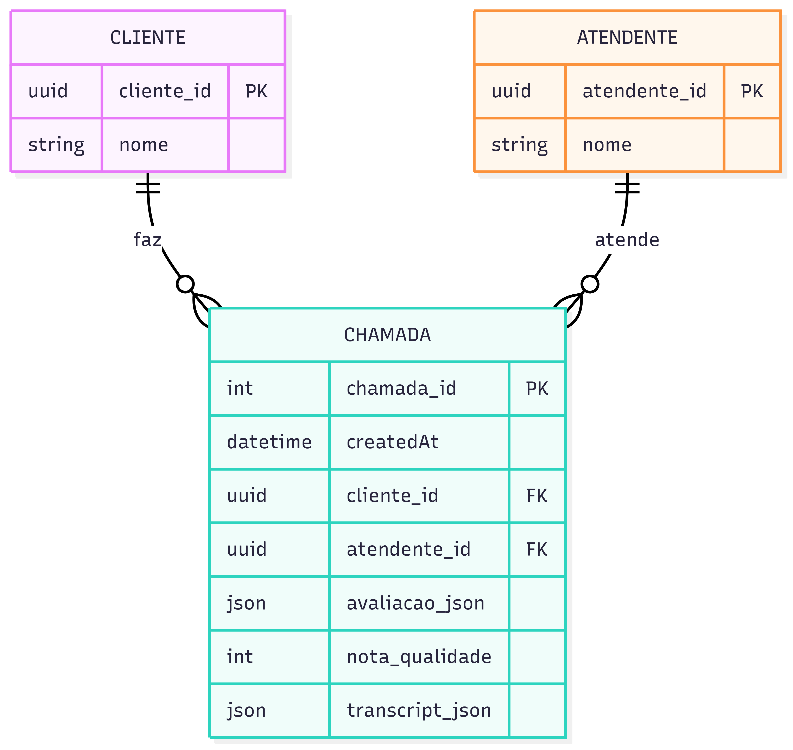<br>
<sup>Fonte: Material produzido pelos autores (2025)</sup>
</div>

<div align="center">
<sub>Figura 4.1.2 - Diagrama do Banco Vetorial</sub><br>
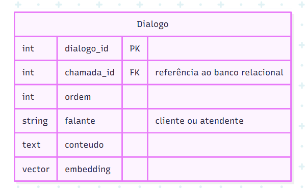<br>
<sup>Fonte: Material produzido pelos autores (2025)</sup>
</div>

### 4.1.1. Identificação das Entidades

1. **CLIENTE**  
   Representa a pessoa que realizou uma chamada no sistema. Cada cliente pode estar associado a diversas chamadas registradas.

2. **ATENDENTE**  
   Entidade que descreve o profissional responsável por atender a chamada. Um atendente pode realizar múltiplos atendimentos ao longo do tempo.

3. **CHAMADA**  
   Entidade central que registra cada ligação realizada entre um Cliente e um Atendente.  
   Armazena a data/hora de criação, a avaliação do atendimento (em formato JSON), a nota de qualidade atribuída e a transcrição da conversa (também em JSON).  
   Cada chamada está associada a um único Cliente e a um único Atendente, mas tanto Cliente quanto Atendente podem estar vinculados a várias chamadas diferentes.

4. **DIALOGO** *(Banco Vetorial)*  
   Representa cada trecho ou mensagem dentro de uma chamada. Cada registro armazena o conteúdo textual, o falante (cliente ou atendente), a ordem da fala e o embedding vetorial para pesquisas semânticas.  
   Cada diálogo está associado a uma única chamada do banco relacional.

---

### 4.1.2. Estabelecimento das Relações

1. **CLIENTE** – **CHAMADA**  
   - Relação **1:N** (um Cliente pode realizar várias chamadas).  
   - Do ponto de vista do banco de dados, `CHAMADA` contém a chave estrangeira `cliente_id` que aponta para `CLIENTE.cliente_id`.  
   - Exemplo: um mesmo Cliente pode ligar diversas vezes em dias diferentes, cada ligação sendo registrada como uma nova CHAMADA.

2. **ATENDENTE** – **CHAMADA**  
   - Relação **1:N** (um Atendente pode atender diversas chamadas).  
   - `CHAMADA` contém a chave estrangeira `atendente_id` que aponta para `ATENDENTE.atendente_id`.  
   - Exemplo: o mesmo Atendente pode atender clientes diferentes ao longo do expediente, gerando vários registros de CHAMADA.

3. **CHAMADA** – **DIALOGO**  
   - Relação **1:N** (uma chamada pode conter vários diálogos).  
   - `DIALOGO` contém a chave estrangeira `chamada_id` que referencia `CHAMADA.chamada_id`.  
   - Cada registro de diálogo inclui o conteúdo textual, o falante, a ordem da fala e o embedding vetorial.  
   - Essa relação permite consultas semânticas e análises mais detalhadas de cada conversa.

---

### 4.1.3. Fluxo Geral

- Um **CLIENTE** é a pessoa que entra em contato com o sistema realizando chamadas. Ele é identificado unicamente por seu `cliente_id` e pode originar diversas chamadas ao longo do tempo.  

- Um **ATENDENTE** é o profissional responsável por receber e conduzir as chamadas realizadas pelos Clientes. Cada Atendente pode atender vários Clientes diferentes em momentos distintos.  

- Cada **CHAMADA** é um registro histórico que descreve a interação entre Cliente e Atendente. A chamada contém a data/hora em que ocorreu (`createdAt`), a avaliação realizada (em formato JSON), a **nota de qualidade** atribuída e o **transcript** da conversa armazenado em JSON.  

- Cada **DIALOGO** é um trecho específico de uma chamada, armazenado com seu conteúdo textual, falante, ordem e embedding vetorial, permitindo buscas semânticas e análises detalhadas do diálogo.

---

### 4.1.4. Sobre a Modelagem Lógica

Embora o modelo conceitual represente quatro entidades distintas (**CLIENTE**, **ATENDENTE**, **CHAMADA** e **DIALOGO**) para facilitar o entendimento das relações e do fluxo de dados, na implementação prática essa separação não será totalmente mantida.

Devido a restrições legais e de conformidade com a **LGPD (Lei Geral de Proteção de Dados)**, o sistema **não armazenará informações de identificação pessoal de Clientes ou Atendentes**.  
Assim, na **modelagem lógica e física** do banco de dados:

- Todos os registros de chamadas estarão consolidados na tabela **CHAMADA**, contendo apenas dados necessários para auditoria, análise de qualidade e histórico de interações (`chamada_id`, `createdAt`, `avaliacao_json`, `nota_qualidade`, `transcript_json`).  
- A tabela **DIALOGO** armazenará os trechos das chamadas e seus embeddings, permitindo buscas vetoriais sem expor dados pessoais.  

Dessa forma, garantimos a integridade do modelo conceitual para fins acadêmicos e de documentação, ao mesmo tempo em que respeitamos os limites legais na modelagem real do projeto.

## 4.2 Modelo Lógico de Dados

Aqui está o modelo lógico da solução:

<div align="center">
<sub>Figura 4.1.1 - Modelagem Lógica Relacional</sub><br>
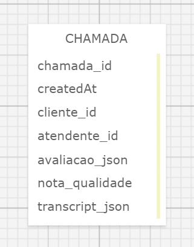<br>
<sup>Fonte: Material produzido pelos autores (2025) </sup>
</div>

Como supracitado na seção anterior, o banco de dados será formado por apenas uma tabela, onde clientes e atendentes são apenas tabelas representativas, mas não existirão.

<div align="center">
<sub>Figura 4.1.1 - Modelagem Lógica Vetorial</sub><br>
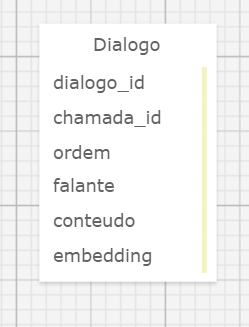<br>
<sup>Fonte: Material produzido pelos autores (2025) </sup>
</div>

O banco vetorial será utilizado para consultas dos usuários, ele será uma unica tabela com todos os dados da chamada armazenados.

## 4.3 Modelo Físico de Dados

_conteúdo_

**Nota:** Insira uma explicação e direcionamento para o readme.md da pasta database.

# 5. Solução Técnica (Design)

Esta seção busca mostrar os diagramas que vão compor a solução final.

## 5.1 Diagrama de Classes

&emsp; Um Diagrama de Classes UML é essencial para a identificação das principais entidades de uma aplicação, seus atributos, métodos e relacionamentos. Esse tipo de diagrama permite visualizar como cada classe interage com as demais.

&emsp; A seguir, apresenta-se o Diagrama de Classes para o sistema de gestão de chamadas, transcrições e avaliações de atendimento.

<div align="center">
<sub>Figura 5.1.1 - Diagrama de Classes</sub><br>
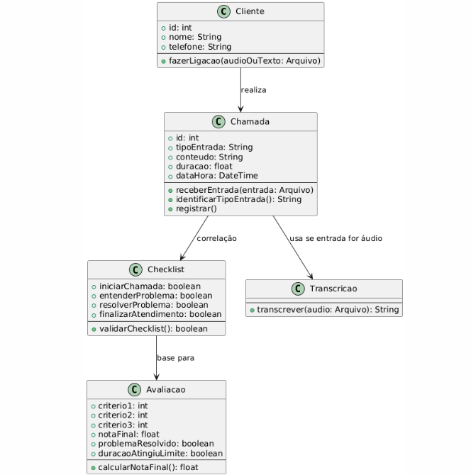<br>
<sup>Fonte: Material produzido pelos autores (2025) </sup>
</div>

| Classe | Descrição |
| :--- | :--- |
| **Cliente** | Representa o cliente que realiza chamadas. Contém informações básicas como `id`, `nome` e `telefone`, e o método `fazerLigacao` para iniciar uma chamada. |
| **Chamada** | Registra os dados de cada chamada, incluindo `tipoEntrada`, `conteudo`, `duracao` e `dataHora`. Possui métodos para `receberEntrada`, `identificarTipoEntrada` e `registrar`. Serve como base para a transcrição e checklist. |
| **Checklist** | Classe responsável pelo acompanhamento do atendimento. Possui atributos booleanos como `iniciarChamada`, `entenderProblema`, `resolverProblema` e `finalizarAtendimento`. Inclui o método `validarChecklist` e mantém correlação com a **Avaliacao**. |
| **Avaliacao** | Representa a avaliação do atendimento baseada no checklist, incluindo critérios numéricos (`criterio1`, `criterio2`, `criterio3`), `notaFinal` e flags de acompanhamento (`problemaResolvido`, `duracaoAtingiuLimite`). Possui o método `calcularNotaFinal`. |
| **Transcricao** | Classe responsável por processar entradas de áudio. Contém o método `transcrever` que recebe um arquivo de áudio e retorna a transcrição em formato de string. |

### **Relacionamentos Entre as Classes**

1. **Cliente → Chamada**
   - O Cliente realiza uma Chamada, iniciando o fluxo de atendimento. Essa etapa, o usuário vai imputar os dados da chamada que já ocorreu.
   <br>

2. **Chamada → Checklist**
   - A Chamada mantém uma correlação com o Checklist, permitindo acompanhar o progresso do atendimento.
   <br>

3. **Checklist → Avaliacao**
   - O Checklist serve como base para gerar uma Avaliacao do atendimento, calculando a nota final e verificando se os critérios foram cumpridos.
   <br>

4. **Chamada → Transcricao**
   - A Chamada utiliza a classe Transcricao quando a entrada é do tipo áudio, convertendo o áudio em texto para análise posterior.


## 5.2 Diagrama de Componentes da UML

&emsp; Um Diagrama de Componentes UML é essencial para a identificação dos principais módulos de uma aplicação, seus relacionamentos e suas responsabilidades dentro de uma arquitetura de software. Esse tipo de diagrama permite visualizar, de forma modular, como cada parte do sistema se comunica, garantindo organização, coesão e clareza estrutural.

&emsp; A seguir, apresenta-se o Diagrama de Componentes para o sistema de análise automática de transcrições de áudios.

<div align="center">
<sub>Figura 5.2.1 - Diagrama de Componentes </sub><br>
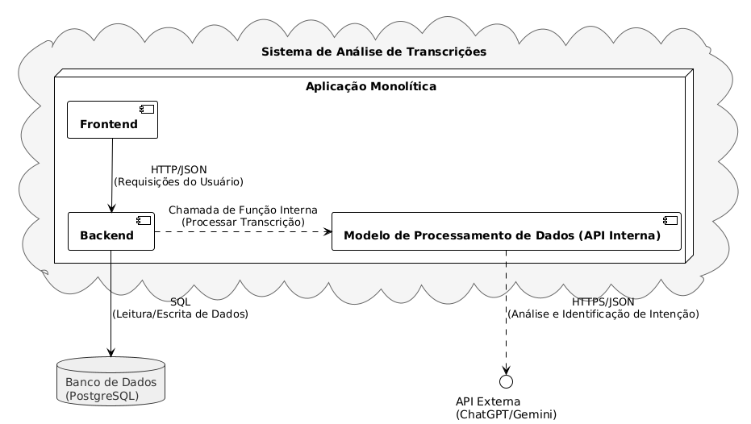<br>
<sup>Fonte: Material produzido pelos autores (2025) </sup>
</div>

| Componente                                         | Descrição                                                                                                                                                  |
| :------------------------------------------------- | :--------------------------------------------------------------------------------------------------------------------------------------------------------- |
| **Aplicação Monolítica**                           | Representa o sistema centralizado que integra todos os componentes internos para fornecer as funcionalidades de transcrição e análise de áudio.            |
| **Frontend**                                       | Interface web que permite ao operador fazer o upload dos arquivos de áudio, visualizar as transcrições e os resultados da análise de intenção.             |
| **Backend**                                        | Responsável por receber as requisições do frontend, gerenciar a lógica de negócio, orquestrar o processamento dos dados e persistir as informações.        |
| **Banco de Dados (PostgreSQL)**                    | Armazena os dados da aplicação, como informações dos arquivos de áudio, as transcrições geradas e os resultados da análise (reclamações, elogios, etc.).   |
| **Modelo de Processamento de Dados (API Interna)** | Componente interno que realiza a transcrição do áudio e se comunica com serviços externos para identificar as intenções do cliente no texto transcrito.    |
| **API Externa (ChatGPT/Gemini)**                   | Serviço de IA externo utilizado pelo Modelo de Processamento para analisar o texto da transcrição e identificar com alta precisão as intenções do cliente. |

### **Divisão interna da Aplicação Monolítica**

O **Frontend** permite a interação do usuário final com a aplicação, garantindo a usabilidade para os operadores. Dentro do mesmo sistema, o **Backend** gerencia as requisições, coordena o fluxo de trabalho e interage diretamente com o **Banco de Dados (PostgreSQL)** para persistência. Quando uma análise é solicitada, o Backend aciona o **Modelo de Processamento de Dados**, que atua como uma API interna. Este modelo, por sua vez, consome a **API Externa (ChatGPT/Gemini)** para realizar a análise de sentimento e intenção, garantindo a segurança ao não expor dados sensíveis diretamente.

### **Relacionamentos Entre os Componentes**

1.  **Frontend** → **Backend**

    - O Frontend envia requisições do usuário (como upload de áudio) para o Backend via chamadas HTTP/JSON.
      <br>

2.  **Backend** ↔ **Banco de Dados (PostgreSQL)**

    - O Backend lê e grava informações no Banco de Dados, como o estado do processamento e os resultados da análise, garantindo a persistência dos dados.
      <br>

3.  **Backend** → **Modelo de Processamento de Dados (API Interna)**

    - O Backend invoca o Modelo de Processamento através de uma chamada de função interna para iniciar a análise de um arquivo de áudio.
      <br>

4.  **Modelo de Processamento de Dados** → **API Externa (ChatGPT/Gemini)**
    - O Modelo de Processamento envia o texto transcrito para a API Externa para obter a análise de intenção e sentimento.
      <br>

## 5.3 Diagramas de Sequência da UML

&emsp; Um Diagrama de Sequência UML é essencial para entender o fluxo temporal de interações entre os componentes de um sistema durante a execução de um processo. Este tipo de diagrama permite visualizar a ordem das mensagens trocadas, os responsáveis por cada ação e como os dados são processados ao longo do fluxo.

&emsp; A seguir, apresenta-se o Diagrama de Sequência para o fluxo de avaliação de chamadas.

<div align="center">
<sub>Figura 5.3.1 - Diagrama de Sequência </sub><br>
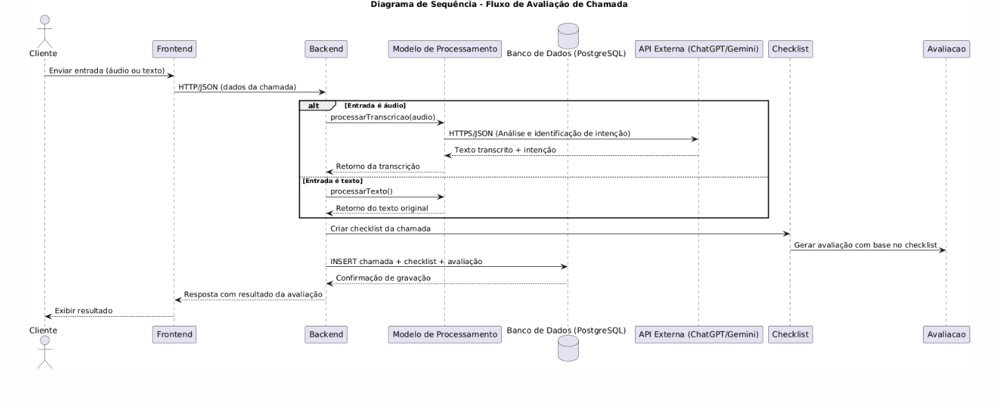<br>
<sup>Fonte: Material produzido pelos autores (2025)</sup>
</div>

| Elemento | Descrição |
| :--- | :--- |
| **Cliente** | Inicia o processo enviando uma entrada, que pode ser um áudio ou texto, para avaliação. |
| **Frontend** | Recebe a entrada do cliente, envia os dados para o backend via HTTP/JSON e exibe o resultado final da avaliação. |
| **Backend** | Gerencia o fluxo do processamento, coordenando chamadas para APIs externas, modelo de processamento, checklist e persistência em banco de dados. |
| **Modelo de Processamento** | Interpreta a entrada textual (seja transcrita ou digitada), consulta o banco vetorial em busca de contexto relevante e integra essas informações antes de enviar ao LLM. |
| **Banco de Dados (PostgreSQL)** | Persiste informações da chamada, checklist e avaliação, garantindo rastreabilidade e histórico do fluxo. |
| **Banco Vetorial** | Armazena embeddings semânticos que permitem consultas por similaridade, possibilitando enriquecer a análise do LLM com informações relevantes. |
| **API Externa de Transcrição** | Responsável por converter áudios enviados pelo cliente em texto, retornando a transcrição ao backend. |
| **API Externa LLM (ChatGPT/Gemini)** | Recebe o texto (digitado ou transcrito) junto com o contexto recuperado do banco vetorial e realiza a análise de intenção, retornando os resultados ao modelo de processamento. |
| **Checklist** | Cria um checklist da chamada baseado nos dados recebidos para auxiliar na avaliação. |
| **Avaliação** | Gera a avaliação final com base no checklist e retorna o resultado ao backend, que envia ao frontend para exibição ao cliente. |


# 6. Mapeamento Técnico de Infraestrutura e Implantação

_conteúdo_

## 6.1 Diagrama de Implantação da UML

_conteúdo_

## 6.2 Justificativa das Escolhas de Implantação

### 6.2.1 Processo de Deploy do Modelo

Este documento descreve o processo de deploy em produção de um algoritmo de NLP (BERT + Regex + TF-IDF) usando Google Cloud Run.  


**1. Pré-requisitos**

- Conta ativa no [Google Cloud](https://cloud.google.com/)
- Faturamento habilitado no projeto
- [Google Cloud CLI](https://cloud.google.com/sdk/docs/install) instalada e configurada (`gcloud init`)
- [Docker](https://docs.docker.com/get-docker/) instalado localmente


**2. Criar projeto e habilitar serviços**

1. Acesse o [Console do Google Cloud](https://console.cloud.google.com/)
2. Crie um novo projeto (ex.: `nlp-deploy`)
3. Ative o faturamento
4. Vá em **APIs & Services → Enabled APIs** e habilite:
   - **Cloud Run**
   - **Artifact Registry**
   - **Cloud Build**


**3. Criar repositório no Artifact Registry**

No terminal:

```bash
gcloud artifacts repositories create nlp-images \
  --repository-format=docker \
  --location=us-central1 \
  --description="Repositório de imagens NLP"
```

Verifique se o repositório foi criado:

```bash
gcloud artifacts repositories list
```

**4. Build e Push da Imagem Docker**

Autenticar o Docker para o Artifact Registry:

```bash
gcloud auth configure-docker
```

Definir variáveis:

```bash
PROJECT_ID=$(gcloud config get-value project)
REGION=us-central1
IMAGE=${REGION}-docker.pkg.dev/${PROJECT_ID}/nlp-images/nlp-api:1.0
```

Build e push:

```bash
docker build -t ${IMAGE} .
docker push ${IMAGE}
```

**5. Deploy no Cloud Run**

Executar o deploy:

```bash
gcloud run deploy nlp-api \
  --image=${IMAGE} \
  --region=${REGION} \
  --platform=managed \
  --allow-unauthenticated \
  --cpu=2 \
  --memory=4Gi \
  --max-instances=5 \
  --set-env-vars=BERT_MODEL=joeddav/xlm-roberta-large-xnli,W_TFIDF=0.4,W_BERT=0.6
```

Obs: Ajuste os valores de CPU, memória e variáveis de ambiente conforme sua necessidade.

Ao final, será exibida uma URL pública (ex.: https://nlp-api-xxxx-uc.a.run.app).

**6. Testar o serviço**

Via curl:
```curl
curl -X POST "https://SUA-URL/predict" \
  -H "Content-Type: application/json" \
  -d '{
        "texts": ["Exemplo de frase para análise"],
        "candidate_labels": ["esporte", "política", "tecnologia"]
      }'
```

**7. Monitorar logs**

Verifique as chamadas e erros:

```bash
gcloud run services logs read nlp-api --region ${REGION}
```

Ou pelo Console → Cloud Run → nlp-api → Logs.

**8. Checklist de Capturas de Tela (para documentação)**

 Projeto criado e selecionado no Console

 Billing habilitado

 APIs ativadas (Cloud Run, Artifact Registry, Cloud Build)

 Repositório nlp-images criado

 Terminal com saída do docker push

 Tela de configuração do serviço no Cloud Run

 URL pública do serviço rodando

 Teste com curl ou Postman retornando JSON

 Logs mostrando requisições bem-sucedidas

**9. Boas práticas**

Configure variáveis de ambiente para pesos e modelos (ex.: W_TFIDF, W_BERT, BERT_MODEL).

Habilite min-instances > 0 para reduzir cold start.

Use IAM se quiser restringir o acesso (remova --allow-unauthenticated).

Faça versionamento de imagens (1.0, 1.1, etc.) para rollback rápido.

## 6.3 Considerações sobre Desempenho e Segurança

_conteúdo_

# 7. Projeto Visual da Solução

&ensp;Esta seção detalha a proposta de experiência do usuário (UX) e o design visual para a plataforma de automação da monitoria de qualidade.  
&ensp;As seções a seguir representam o protótipo de alta fidelidade desenvolvido no **Figma**, que serve como um guia fiel para a implementação da interface.

### Nossa Proposta de UX se Baseia em Quatro Pilares Fundamentais

- **Usabilidade e Eficiência:** Interface dividida em duas seções principais (Dashboard e Chat), permitindo dois modos de análise: um visual/exploratório e um conversacional/direto.  
- **Interfaces Intuitivas:** Padrões de design universalmente reconhecidos (cartões para dados, tabelas, interface de chat).  
- **Acessibilidade:** Uso de fontes legíveis, bom contraste entre texto e fundo, navegação via teclado e comandos de voz.  
- **Facilidade de Aprendizado:** Curva de aprendizado mínima, permitindo que um novo usuário extraia valor desde a primeira sessão.  

---

### O Poder das Tags: Resumos Inteligentes

&ensp;Um elemento central da proposta de UX são as **Tags**, etiquetas automáticas geradas pela IA após analisar o conteúdo da transcrição.  
&ensp;Uma mesma chamada pode ter múltiplas tags, como:

- Sentimento Negativo  
- Script Incompleto  
- Elogio  
- Resolvido  
- Transferência Digital  

---

### Conectando o Design com as Personas

| **Elemento da Interface**       | **Dor/Objetivo da Persona (Carlos Martins)**                                                                 | **Dor/Objetivo da Persona (Julia Souza)** |
|---------------------------------|---------------------------------------------------------------------------------------------------------------|--------------------------------------------|
| **Cards de KPI**                | Resolve a dor: "Dificultando a visão real do desempenho."<br>Atende ao objetivo: "Ter relatórios objetivos."   | Atende ao interesse: "Obter métricas consolidadas sobre transferências." |
| **Tabela de Chamadas com Ordenação** | Fornece visão rápida das análises, permitindo ordenar por pontuação e encontrar os melhores/piores casos.         | Permite visualizar chamadas marcadas com a tag *Transferência Digital*. |
| **Página de Chat**              | Resolve a dor: "Treinamentos genéricos, pouco adaptados."<br>Atende ao objetivo: "Identificar padrões rapidamente." | Atende ao interesse: "Visão clara do canal digital e seus pontos de falha." |
| **Modal de Detalhes da Chamada**| Atende ao objetivo: "Identificar padrões para embasar treinamentos mais eficazes", com apoio do "Ponto de vista da IA". | Permite análise profunda da transcrição de chamadas de transferência. |
| **Botão "+ Analisar chamada"**  | Oferece a possibilidade de aumentar a amostragem de monitoria, saindo do 1% manual.                             | N/A |

---

## 7.1 e 7.2 Do Wireframe ao Mockup: A Evolução Visual

&ensp;A seguir, apresentamos a evolução do design, desde a estrutura básica do **wireframe** até o resultado final em **alta fidelidade**.  
&ensp;O formato lado a lado demonstra como as diretrizes do **Guia Visual** foram aplicadas para transformar o esqueleto funcional em uma interface coesa e polida. Para uma melhor experiencia, veja pelo link do figma [Aqui!](https://www.figma.com/design/5TtflqiZYoHFqskrUrC7hC/Wireframe-e-prot%C3%B3tipo-de-alta-fidelidade-Gas-Protect-Team?node-id=42-900&t=jBWobfOyOwWMA5ju-1)


### Tela Principal (Dashboard)

&ensp;Primeira tela visualizada pelo usuário, projetada para fornecer visão geral e rápida da qualidade do atendimento.

**Wireframe (Estrutura)**  
**Resultado Final (Mockup)**  

<div align="center"><sub>Figura 1 - Estrutura do Dashboard</sub> <br> 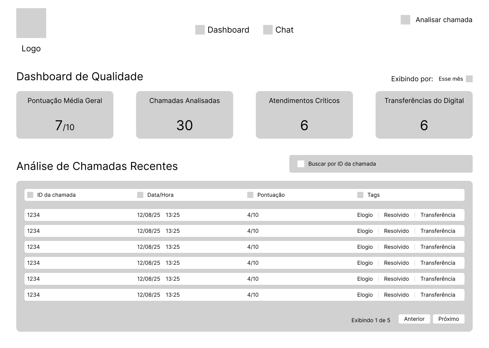</div>  

<div align="center"><sub>Figura 2 - Mockup do Dashboard</sub> <br> 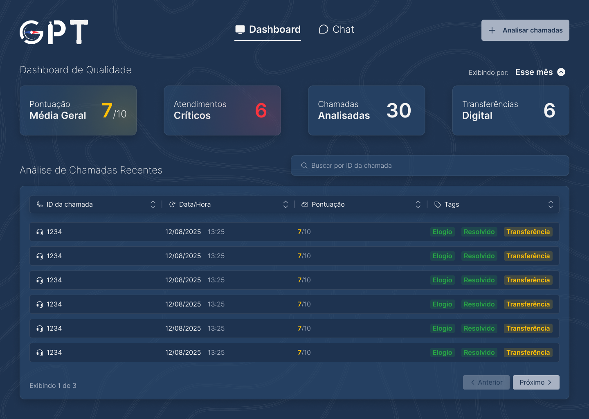</div>  

<sup style="text-align: center;">Fonte: Material produzido pelos autores (2025).</sup>  

---

### Análise Interativa (Chat)

&ensp;A tela de **Chat** é a principal ferramenta para investigações aprofundadas, usando interface conversacional para obter respostas diretas da IA.

**Wireframe (Estrutura)**  
**Resultado Final (Mockup)**  

<div align="center"><sub>Figura 3 - Estrutura do Chat</sub> <br> 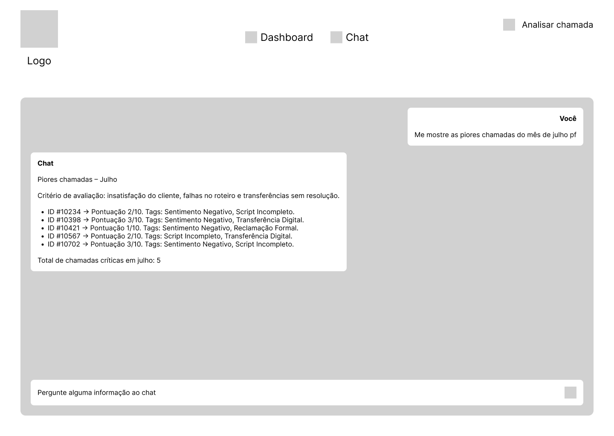</div>  

<div align="center"><sub>Figura 4 - Mockup do Chat</sub> <br> 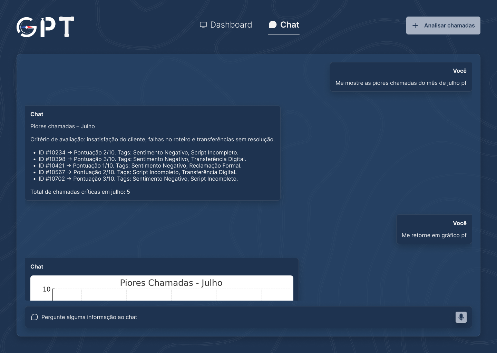</div>  

<sup style="text-align: center;">Fonte: Material produzido pelos autores (2025).</sup>  

---

### Fluxo de Análise e Detalhes (Modais)

&ensp;O fluxo de análise de uma nova chamada e a visualização de detalhes de uma chamada existente ocorrem em **modais**, mantendo o usuário no contexto do dashboard.

**Wireframe (Estrutura)**  
**Resultado Final (Mockup)**  

<div align="center"><sub>Figura 5 - Estrutura do Modal de Input</sub> <br> 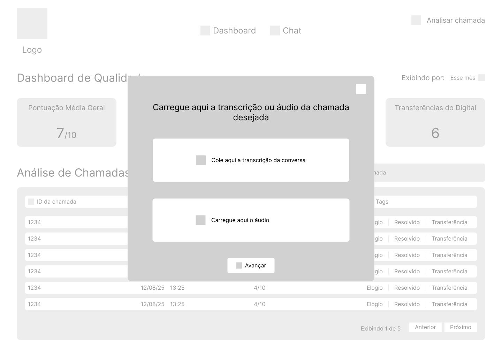</div>  

<div align="center"><sub>Figura 6 - Mockup do Modal de Input</sub> <br> 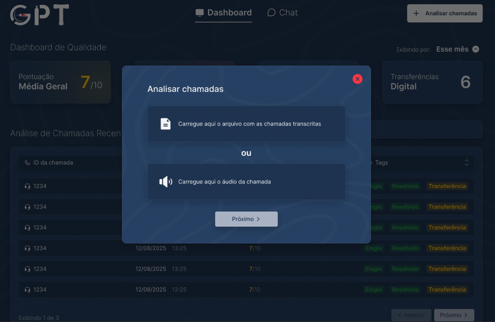</div>  

<div align="center"><sub>Figura 7 - Estrutura do Modal de Detalhes</sub> <br> 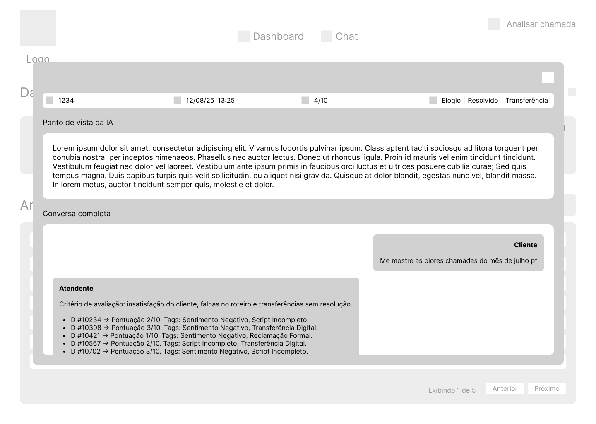</div>  

<div align="center"><sub>Figura 8 - Mockup do Modal de Detalhes</sub> <br> 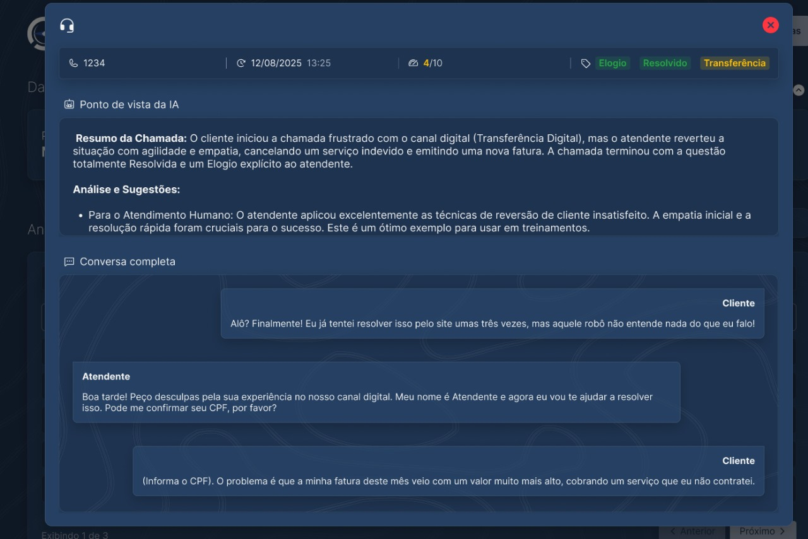</div>  

<sup style="text-align: center;">Fonte: Material produzido pelos autores (2025).</sup>  

---

## 7.3 Guia Visual (Style Guide)

&ensp;Este guia define os padrões visuais da aplicação para garantir consistência, clareza e identidade coesa.

### Paleta de Cores (Dark Mode)

- **Fundo Principal:** Azul escuro (#1e3350)  
- **Fundo de Elementos:**  
  - Translúcido (#2a4a6e, 60% opacidade) – usado em cards e tabelas  
  - Sólido (#254062) – usado em modais  
- **Cor de Destaque:** Vermelho (#ff353f)  
- **Texto Principal:** Branco (#f4f4f4)  
- **Texto Secundário:** Cinza azulado (#A8B2C3)  
- **Cores de Status:**  
  - Verde (#28a745)  
  - Amarelo (#ffc107)  
  - Vermelho (#ff353f)  

### Tipografia

- **Fonte:** Inter  
- **Pesos:**  
  - Extra Light: Títulos principais  
  - Regular: Corpo de texto  
  - Semibold: Destaques (KPIs, etc.)  

### Layout e Estrutura

- Uso de **CSS Flexbox** para garantir responsividade e alinhamento.  
- **Espaçamento:** Sistema baseado em múltiplos de 4px.  

### Arredondamento (Border Radius)

- **4px e 6px:** Elementos pequenos e interativos (botões, inputs).  
- **8px e 12px:** Contêineres maiores (cards, modais).  

### Profundidade e Sombras

- **Borda Sutil:** 1px com cor do texto (#f4f4f4), baixa opacidade (5%–10%).  
- **Sombra Difusa:** #000000 com 20% de opacidade, para efeito de flutuação.  

### Iconografia

- Biblioteca: **Phosphor Icons**.  

---

### O que NÃO Fazer (Antipadrões)

- ❌ Usar cores fora da paleta definida.  
- ❌ Ignorar a hierarquia de fontes.  
- ❌ Usar valores de espaçamento "mágicos".  
- ❌ Misturar estilos de arredondamento.  
- ❌ Aplicar sombras pretas e duras em fundos escuros.  

# 8. Desenvolvimento do Projeto

_conteúdo_

## 8.1 Arquitetura de Codificação e Estrutura de Diretórios

_conteúdo_

## 8.2 API de Áudio

### 8.2.1 API para Receber os Áudios Enviados pelo Usuário

### Endpoint Disponível

#### **1. Receive Audio Call**

* **Endpoint:** `/api/receiveAudioCall`
* **Método HTTP:** `POST`
* **Descrição:** Este endpoint permite que o usuário envie um arquivo de áudio contendo uma chamada de atendimento. O sistema valida o formato, armazena temporariamente o arquivo, realiza a transcrição automática e envia a consulta para o banco de dados.

### Parâmetros de Entrada

* **Body (form-data / multipart):**

  * `audio` *(obrigatório)*: arquivo de áudio enviado pelo usuário.

#### **Regras do Arquivo de Áudio**

* **Formatos suportados:** `.mp3`, `.wav`
* **Tamanho máximo:** `5 MB`
* **Duração suportada:** até `75 minutos`
* **Requisitos adicionais:**

  * O áudio deve estar em boa qualidade.
  * Apenas 1 arquivo por requisição.

### Respostas Esperadas

#### **Sucesso (200 OK)**

```json
{
  "success": true,
  "message": "Audio received successfully. Transcription started.",
  "data": {
    "audioId": "12345",
    "status": "processing"
  },
  "timestamp": "2025-08-19T16:45:00Z"
}
```

#### **Erro de Validação (400 Bad Request)**

```json
{
  "success": false,
  "message": "Invalid audio format. Accepted formats: .mp3, .wav"
}
```

#### **Erro no Servidor (500 Internal Server Error)**

```json
{
  "success": false,
  "message": "Error while processing audio. Please try again later."
}
```

### Integração com ChatGPT (Prompt Definido)

Após o recebimento do áudio, o sistema gera a transcrição e envia o seguinte **prompt** ao ChatGPT:

```text
Você é um analizador de intenção de chamada.
Input: Transcrição do áudio.
Task: Identificar a intenção do cliente (reclamações, elogios, profanidades, etc.)
Output: SQL query para inserir o resultado na tabela `call_intentions`.
```

#### Exemplo de Saída Esperada (query SQL)

```sql
INSERT INTO call_intentions (audio_id, intention, confidence, created_at)
VALUES ('12345', 'Complaint', 0.92, NOW());
```

### UML – Diagrama de Sequência

<div align="center">
  <sub>Figura 8.2.1 - Diagrama Sequência UML - Áudio</sub> <br>

  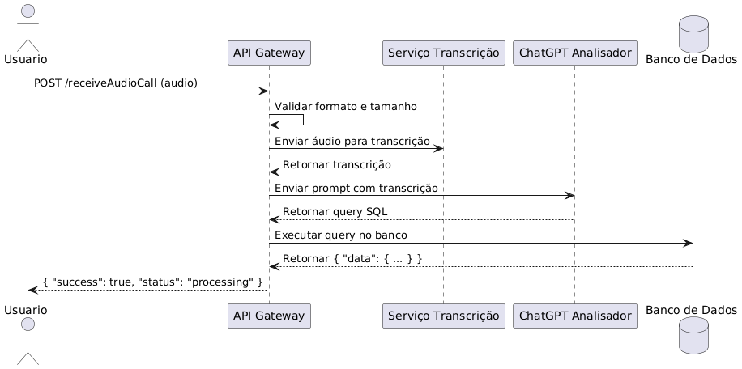

  <sup>Fonte: Material produzido pelos autores (2025).</sup>
</div>

### Exemplos de Uso

#### **Exemplo 1: cURL**

```bash
curl -X POST http://api.comgas.com/api/receiveAudioCall \
  -H "Content-Type: multipart/form-data" \
  -F "audio=@ligacao_cliente_vazamento.mp3"
```

#### **Exemplo 2: JavaScript (Frontend)**

```javascript
// Quando usuário seleciona arquivo de áudio no sistema da Comgás
const audioFile = document.getElementById('audioUpload').files[0];
const formData = new FormData();
formData.append('audio', audioFile);

fetch('/api/receiveAudioCall', {
  method: 'POST',
  body: formData
})
.then(response => response.json())
.then(data => {
  console.log('Áudio enviado:', data.audioId);
  // Mostra para usuário que análise de qualidade começou
});
```

#### **Exemplo 3: Python (Backend)**

```python
import requests

def processar_audio_comgas(caminho_audio):
    url = "http://api.comgas.com/api/receiveAudioCall"
    files = {'audio': open(caminho_audio, 'rb')}
    
    response = requests.post(url, files=files)
    return response.json()

# Exemplo de uso no sistema interno
resultado = processar_audio_comgas('chamada_atendimento_gas.wav')
print(f"Audio ID: {resultado['data']['audioId']}")
print(f"Status: {resultado['data']['status']}")
```

### 8.2.2 API para Implementar a Etapa de Speech to Text e Text to Speech

#### Endpoints Disponíveis

##### **1. Speech to Text (Whisper API)**

* **Endpoint:** `https://api.openai.com/v1/audio/transcriptions`
* **Método HTTP:** `POST`
* **Descrição:** Este endpoint da OpenAI permite converter arquivos de áudio em texto utilizando o modelo Whisper. O sistema envia o arquivo de áudio recebido e obtém a transcrição completa com identificação de falantes e timestamps.

##### **2. Text to Speech (TTS API)**

* **Endpoint:** `https://api.openai.com/v1/audio/speech`
* **Método HTTP:** `POST`
* **Descrição:** Este endpoint da OpenAI permite converter texto em áudio sintetizado. Utilizado para gerar respostas automáticas ou feedback de qualidade em formato de áudio para o usuário.

#### Parâmetros de Entrada

##### **Speech to Text**

* **Headers:**
  * `Authorization: Bearer {OPENAI_API_KEY}` *(obrigatório)*
  * `Content-Type: multipart/form-data` *(obrigatório)*

* **Body (form-data / multipart):**
  * `file` *(obrigatório)*: arquivo de áudio para transcrição
  * `model` *(obrigatório)*: modelo a ser utilizado (whisper-1)
  * `language` *(opcional)*: idioma do áudio (pt)
  * `response_format` *(opcional)*: formato da resposta (json, text, srt, verbose_json, vtt)

##### **Text to Speech**

* **Headers:**
  * `Authorization: Bearer {OPENAI_API_KEY}` *(obrigatório)*
  * `Content-Type: application/json` *(obrigatório)*

* **Body (JSON):**
  * `model` *(obrigatório)*: modelo TTS a ser utilizado (tts-1, tts-1-hd)
  * `input` *(obrigatório)*: texto para conversão em áudio
  * `voice` *(obrigatório)*: tipo de voz (alloy, echo, fable, onyx, nova, shimmer)
  * `response_format` *(opcional)*: formato de áudio (mp3, opus, aac, flac)
  * `speed` *(opcional)*: velocidade da fala (0.25 a 4.0)

#### Regras dos Arquivos

##### **Speech to Text**

* **Formatos suportados:** `.mp3`, `.mp4`, `.mpeg`, `.mpga`, `.m4a`, `.wav`, `.webm`
* **Tamanho máximo:** `25 MB`
* **Duração suportada:** sem limite específico
* **Requisitos adicionais:**
  * O áudio deve estar em qualidade adequada para transcrição
  * Suporte a múltiplos idiomas

##### **Text to Speech**

* **Tamanho máximo do texto:** `4096 caracteres`
* **Formatos de saída:** `.mp3`, `.opus`, `.aac`, `.flac`
* **Requisitos adicionais:**
  * Texto deve estar em formato UTF-8
  * Suporte a múltiplas vozes e velocidades

#### Respostas Esperadas

##### **Speech to Text - Sucesso (200 OK)**

```json
{
  "text": "Alô, Comgás, bom dia. Como posso ajudá-lo? Bom dia, eu gostaria de relatar um vazamento de gás na minha rua."
}
```

##### **Speech to Text - Formato Verbose (200 OK)**

```json
{
  "task": "transcribe",
  "language": "portuguese",
  "duration": 45.2,
  "text": "Alô, Comgás, bom dia. Como posso ajudá-lo? Bom dia, eu gostaria de relatar um vazamento de gás na minha rua.",
  "words": [
    {
      "word": "Alô",
      "start": 0.0,
      "end": 0.5
    },
    {
      "word": "Comgás",
      "start": 0.6,
      "end": 1.2
    }
  ]
}
```

##### **Text to Speech - Sucesso (200 OK)**

```
Retorna arquivo de áudio binário no formato especificado
Content-Type: audio/mpeg (para MP3)
```

##### **Erro de Autenticação (401 Unauthorized)**

```json
{
  "error": {
    "message": "Incorrect API key provided",
    "type": "invalid_request_error",
    "code": "invalid_api_key"
  }
}
```

##### **Erro de Validação (400 Bad Request)**

```json
{
  "error": {
    "message": "Invalid file format. Supported formats: mp3, mp4, mpeg, mpga, m4a, wav, webm",
    "type": "invalid_request_error"
  }
}
```

#### Integração com Sistema Interno

Após receber o áudio pelo endpoint `/api/receiveAudioCall`, o sistema realiza as seguintes integrações:

##### **1. Transcrição do Áudio**

```python
import openai

# Configuração da API
openai.api_key = "sua_chave_api_aqui"

# Envio para transcrição
with open("audio_file.mp3", "rb") as audio_file:
    transcript = openai.Audio.transcribe(
        model="whisper-1",
        file=audio_file,
        language="pt",
        response_format="verbose_json"
    )
```

##### **2. Análise da Transcrição**

```python
# Prompt para análise de intenção
prompt = f"""
Você é um analizador de intenção de chamada.
Input: {transcript['text']}
Task: Identificar a intenção do cliente (reclamações, elogios, profanidades, etc.)
Output: SQL query para inserir o resultado na tabela `call_intentions`.
"""

# Envio para ChatGPT
response = openai.ChatCompletion.create(
    model="gpt-3.5-turbo",
    messages=[{"role": "user", "content": prompt}]
)
```

##### **3. Geração de Resposta em Áudio (Opcional)**

```python
# Conversão de texto para áudio
response_audio = openai.Audio.create_speech(
    model="tts-1",
    voice="nova",
    input="Obrigado pelo seu contato. Sua solicitação foi registrada com sucesso."
)
```

#### Exemplo de Saída Esperada (Análise)

```sql
INSERT INTO call_intentions (audio_id, intention, confidence, created_at)
VALUES ('12345', 'Gas_Leak_Report', 0.95, NOW());
```

#### Fluxo de Processamento

1. **Recebimento:** Sistema recebe áudio via `/api/receiveAudioCall`
2. **Transcrição:** Áudio é enviado para Whisper API da OpenAI
3. **Análise:** Transcrição é processada pelo ChatGPT para identificar intenção
4. **Armazenamento:** Resultado é salvo no banco de dados
5. **Resposta:** Sistema pode gerar feedback em áudio via TTS API (opcional)

## 8.3 Algoritmo de NLP Utilizado e sua Implementação

### Visão Geral do Algoritmo

Nosso sistema de análise de qualidade de atendimento da Comgás implementará uma **arquitetura híbrida** que combina três técnicas complementares de Processamento de Linguagem Natural: **BERT** para análise contextual, **Expressões Regulares (Regex)** para detecção de padrões específicos, e **TF-IDF** para identificação de termos relevantes.

Esta abordagem foi escolhida para atender ao objetivo de escalar a análise de qualidade de 1% para 20% das ligações telefônicas, mantendo precisão analítica enquanto usa recursos computacionais de forma eficiente. Cada componente é aplicado aos aspectos para os quais é mais adequado: BERT para análise semântica complexa, regex para critérios objetivos, e TF-IDF para importância estatística de termos.

### Finalidade e Princípios Fundamentais

A **finalidade** do algoritmo é automatizar a avaliação de qualidade de atendimento telefônico, transformando transcrições de áudio em análises estruturadas que permitam identificação proativa de problemas e melhoria contínua dos padrões de atendimento.

Os **princípios fundamentais** que norteiam a implementação são:

**Complementaridade Técnica:** Diferentes abordagens de NLP são aplicadas conforme sua adequação específica. BERT analisa aspectos subjetivos como cordialidade e eficácia na comunicação, aproveitando sua capacidade de compreensão contextual bidirecional. Regex detecta elementos objetivos como números de protocolo e cumprimento de scripts obrigatórios, garantindo alta precisão para padrões bem definidos.

**Customização para Domínio Específico:** Todos os componentes são adaptados para o vocabulário e procedimentos típicos das interações Comgás-cliente, incluindo fine-tuning de BERT com datasets de atendimento, padrões regex adaptados para protocolos da Comgás, e vocabulários TF-IDF específicos do domínio de gás natural.

**Interpretabilidade:** O sistema fornece informações detalhadas sobre os fatores que contribuíram para cada avaliação, permitindo que supervisores compreendam não apenas o score final, mas também os elementos específicos que influenciaram a análise.

### Benefícios da Abordagem Escolhida

A arquitetura híbrida oferece **melhor performance** através da aplicação de técnicas conforme sua adequação. Enquanto BERT requer recursos computacionais significativos para análise contextual profunda, regex opera com velocidade extremamente alta para detecção de padrões específicos, permitindo processamento eficiente de grandes volumes.

A **confiabilidade** é obtida através de redundância analítica inteligente, onde aspectos importantes são avaliados por múltiplos componentes, permitindo validação cruzada e redução de falsos positivos. A **flexibilidade** permite evolução contínua: novos padrões regex podem ser facilmente adicionados, modelos BERT podem ser retreinados, e vocabulários TF-IDF atualizados conforme mudanças nos procedimentos.

### Fusão de Resultados e Ponderação

Os pesos foram definidos para equilibrar compliance objetiva e análise qualitativa: Regex (40%) para garantir conformidade com scripts obrigatórios, protocolos e procedimentos da Comgás; BERT (40%) para capturar aspectos subjetivos como cordialidade, eficácia na comunicação e satisfação do cliente; e TF-IDF (20%) para fornecer contexto estatístico sobre a relevância de termos-chave. Esta distribuição equilibrada reconhece que tanto compliance quanto qualidade de interação são igualmente importantes para o atendimento da Comgás. Estes pesos podem ser ajustados dinamicamente após a validação com dados reais e feedback do parceiro.

### Desafios e Mitigações

**Qualidade das Transcrições:** Um desafio potencial é a variabilidade na qualidade das transcrições de áudio. Para mitigar isso, planejamos incluir uma etapa de pré-processamento para normalizar o texto, corrigir erros comuns de transcrição (como "protocolo" transcrito como "protocólo"), e implementar verificação de confiança baseada nos scores de transcrição fornecidos pela API.

**Manutenção de Padrões Regex:** A complexidade de manter os padrões de Regex atualizados conforme mudanças nos procedimentos da Comgás será mitigada através de um sistema de configuração externa que permite atualização de padrões sem modificação de código, além de logs detalhados para identificar padrões que precisam de refinamento.

**Fine-tuning do BERT:** A necessidade de dados de alta qualidade para o fine-tuning do BERT será atendida através de um processo iterativo de coleta e anotação de dados, começando com um conjunto inicial de transcrições já avaliadas manualmente e expandindo gradualmente conforme o sistema demonstra eficácia.

## Implementação Específica

### Bibliotecas e Frameworks Utilizados

**Para BERT:** Transformers (Hugging Face) com modelo 'neuralmind/bert-base-portuguese-cased', PyTorch para operações de deep learning, e tokenizers adaptados para português brasileiro.

**Para Processamento de Texto:** NLTK para pré-processamento (tokenização, remoção de stopwords, normalização), biblioteca padrão `re` do Python para expressões regulares.

**Para TF-IDF:** Scikit-learn com TfidfVectorizer customizado, pandas para manipulação de dados, numpy para operações matemáticas.

**Para Gerenciamento:** Logging para monitoramento, psutil para métricas de performance, matplotlib para visualizações.

### Fluxo de Processamento

O fluxo de processamento segue a seguinte arquitetura:

```
Transcrição de Áudio
        ↓
   Pré-processamento
   (Normalização, Limpeza)
        ↓
    ┌─────────────────┐
    │   Processamento │
    │    Paralelo     │
    └─────────────────┘
    ↓        ↓        ↓
  BERT     Regex    TF-IDF
(Semântica) (Padrões) (Termos)
    ↓        ↓        ↓
    └─────────────────┘
           ↓
    Fusão Ponderada
    (40% + 40% + 20%)
           ↓
    Score Final de Qualidade
```

### Passos de Configuração

**1. Instalação de Dependências:**
```bash
pip install transformers torch nltk scikit-learn pandas numpy
```

**2. Configuração do BERT:**
```python
from transformers import BertTokenizer, BertForSequenceClassification

tokenizer = BertTokenizer.from_pretrained('neuralmind/bert-base-portuguese-cased')
model = BertForSequenceClassification.from_pretrained(
    'neuralmind/bert-base-portuguese-cased',
    num_labels=5  # 5 níveis de qualidade
)
```

**3. Configuração de Padrões Regex:**
```python
patterns = {
    'protocolo': [r'protocolo\s*:?\s*(\d{4,8})'],
    'identificacao': [r'cpf\s*:?\s*(\d{3}\.?\d{3}\.?\d{3}-?\d{2})'],
    'scripts_obrigatorios': [r'\b(bom\s+dia|boa\s+tarde)\b']
}
```

### Exemplo de Código Demonstrativo

```python
class CallQualityAnalyzer:
    def __init__(self):
        # Inicializa componentes BERT, Regex e TF-IDF
        self.bert_analyzer = BERTQualityAnalyzer()
        self.regex_matcher = RegexPatternMatcher()
        self.tfidf_analyzer = TFIDFAnalyzer()
        
        # Pesos para fusão de resultados (ajustáveis dinamicamente)
        self.weights = {'bert': 0.4, 'regex': 0.4, 'tfidf': 0.2}
    
    def analyze_call(self, transcript, call_id):
        # Pré-processamento da transcrição
        cleaned_transcript = self.preprocess_transcript(transcript)
        
        # Análise BERT para contexto semântico
        bert_score, quality_aspects = self.bert_analyzer.analyze_quality(cleaned_transcript)
        
        # Análise Regex para compliance
        detected_patterns = self.regex_matcher.detect_patterns(transcript)
        regex_score = self.regex_matcher.calculate_compliance_score(detected_patterns)
        
        # Análise TF-IDF para relevância de termos
        key_terms = self.tfidf_analyzer.get_key_terms(cleaned_transcript)
        tfidf_score = self.tfidf_analyzer.calculate_relevance_score(cleaned_transcript)
        
        # Fusão ponderada de resultados
        overall_score = (
            bert_score * self.weights['bert'] +
            regex_score * self.weights['regex'] +
            tfidf_score * self.weights['tfidf']
        )
        
        return {
            'call_id': call_id,
            'overall_score': overall_score,
            'component_scores': {
                'bert': bert_score,
                'regex': regex_score,
                'tfidf': tfidf_score
            },
            'detected_patterns': detected_patterns,
            'key_terms': key_terms,
            'quality_aspects': quality_aspects
        }
    
    def preprocess_transcript(self, transcript):
        """Normaliza e limpa transcrição para análise"""
        # Remove caracteres especiais e normaliza espaçamento
        cleaned = re.sub(r'[^\w\s\.\!\?\,\:\;]', ' ', transcript)
        cleaned = re.sub(r'\s+', ' ', cleaned).strip().lower()
        return cleaned

# Exemplo de uso
analyzer = CallQualityAnalyzer()

transcript = """
Atendente: Bom dia! Comgás, como posso ajudá-lo?
Cliente: Preciso de ajuda com minha conta.
Atendente: Claro! Seu CPF 123.456.789-00? Vou gerar protocolo 12345.
Cliente: Muito obrigado pela eficiência!
"""

result = analyzer.analyze_call(transcript, "DEMO_001")
print(f"Score de Qualidade: {result['overall_score']:.3f}")
print(f"Componentes: BERT={result['component_scores']['bert']:.3f}, "
      f"Regex={result['component_scores']['regex']:.3f}, "
      f"TF-IDF={result['component_scores']['tfidf']:.3f}")
```

Esta implementação demonstra como a arquitetura híbrida processa transcrições de forma eficiente, combinando a capacidade analítica do BERT com a precisão do regex e a relevância estatística do TF-IDF para produzir avaliações completas e confiáveis de qualidade de atendimento.

## 8.4 Desenvolvimento de Features

_conteúdo_

**Nota:** Insira uma explicação de entregas em cada Sprint.

## 8.4.1 Sprint 3

_conteúdo_

## 8.4.2 Sprint 4

_conteúdo_

## 8.4.3 Sprint 5

_conteúdo_

## 8.5 Testes Unitários e de Integração

_conteúdo_
Obs.: Insira informações sobre estratégias para realização dos testes

## 8.6 Documentações automáticas

_conteúdo_
Obs.: Insira informações sobre quais frameworks foram usados e como acessar.

# 9. Planejamento e Execução de Testes

_conteúdo_

## 9.1 Testes Funcionais

_conteúdo_

## 9.1.1 Planejamento

_conteúdo_

## 9.1.2 Resultados

_conteúdo_

## 9.2 Testes de RNFs

_conteúdo_

## 9.2.1 Planejamento

_conteúdo_

## 9.2.2 Resultados

_conteúdo_

## 9.3 Testes de Usabilidade

_conteúdo_

## 9.3.1 Planejamento

_conteúdo_

## 9.3.2 Resultados

_conteúdo_

# 10. Procedimentos de Implantação

_conteúdo_

## 10.1 Implantação e Configuração do Banco de Dados

_conteúdo_

## 10.2 Implantação do Protótipo para uso por equipe de desenvolvimento

_conteúdo_

# Referências

_conteúdo_


